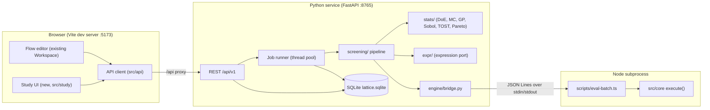

# Lattice — Implementation Plan (for AI coding agents)

> **Audience:** autonomous or semi-autonomous coding agents (and the humans reviewing them).
> **Companion doc:** [ROADMAP.md](./ROADMAP.md) explains *why*. This file explains *exactly what to build, where, in what order, and how to verify it*.
> **Status tracking:** update the [Progress tracker](#13-progress-tracker) at the bottom when a task is finished.

---

## 0. How to use this document (read first)

1. **Work one task at a time, in ID order** (`P0-1`, `P0-2`, …) unless the task's *Depends on* list says otherwise. Each task is sized to fit in one focused session/PR.
2. **Before starting a task**, read: this section, [§2 Current codebase facts](#2-current-codebase-facts-verified), [§3 Target architecture](#3-target-architecture), and the full task text.
3. **A task is done only when** all of its *Acceptance criteria* pass **and** the global [Definition of Done](#11-global-definition-of-done) passes.
4. **Do not skip tests.** Every task lists the tests to add. Statistical code must be tested against known analytic answers with fixed seeds.
5. **When something in this plan conflicts with the code**, trust the code, make the minimal sensible adaptation, and write a note under the task in the progress tracker. Do not silently redesign.
6. **When a task needs a scientific constant, coefficient or dataset that is not in the repo, STOP and ask the human.** Never invent scientific values or cite literature you have not been given. See [§10 Hard rules](#10-hard-rules-for-agents).

### 0.1 Decisions assumed by this plan

ROADMAP §11 left some decisions open. This plan assumes the defaults below. If the human changes any of them, update this table first, then the affected tasks.

| Decision | Assumed default | Why |
|---|---|---|
| Architecture | **Hybrid**: existing React/TS app + new local **Python service** (FastAPI) for storage and statistics | Mature, validated scientific libraries (SciPy, scikit-learn, SALib, statsmodels) |
| Database | **SQLite** via Python stdlib `sqlite3`, hand-written SQL migrations | Zero-ops, single file, easy backup, enough for single-lab scale |
| Simulation engine | **Stays in TypeScript** (`execute()`); Python calls it through a Node CLI subprocess | One engine, no duplicate physics |
| Users | **Single-user, local** first (server binds `127.0.0.1` only, no auth). Multi-user is Phase 6 | Ship value sooner |
| First pilot domain | **Tunnel blast mitigation** (existing demo) + a **data-only drug-screen** example to prove domain-agnosticism | Exercises both "model" and "no model" paths |
| Languages | **English + Georgian**; new UI is written English-first with Georgian dictionary entries | Researcher audience + existing users |
| Python tooling | **Python 3.12**, **uv**, **ruff**, **pytest** | Already installed on dev machine |
| Node | **Node 20 LTS** must be supported | Installed version is v20.20.2 |

---

## 1. Product summary (one paragraph)

A researcher defines a **Study**: the parameters they control (with ranges), the uncertain conditions, the outcomes they measure and what counts as success, hard constraints, and optionally a **model** (a Lattice flow graph). Lattice generates the **candidate experiments**, then runs a **screening pipeline** that removes candidates in stages — hard constraints → model predictions under uncertainty → statistical models fitted to stored evidence → dominance/redundancy — and recommends a small, maximally informative **batch** for the field. Field results are logged as immutable **evidence**, and the screening re-runs. Every exclusion stores *why*, *which evidence/model version*, and *how confident*.

---

## 2. Current codebase facts (verified)

These facts were checked against the code on 2026-10-15. Agents rely on them.

| Fact | Location | Consequence for this plan |
|---|---|---|
| Frontend: React 19 + TypeScript + Vite 7 + `@xyflow/react` + Three.js. **No `vite.config.ts`** exists (Vite runs with defaults, JSX via `tsconfig` `jsx: react-jsx`, no `@vitejs/plugin-react`). | repo root | P0-4 creates `vite.config.ts` (proxy only; do not add the React plugin unless needed). |
| `npm test` uses `node --experimental-strip-types`, which **fails on Node 20**. `npx tsx --test src/core/engine.test.ts` passes all 38 tests. | [package.json](../package.json) | P0-2 switches to `tsx`. |
| `execute(project): Run` is a **pure, deterministic** graph evaluator (apart from `run.id`, `run.at`, timings). Caps samples at **2–10,001** per run. | [runtime.ts](../src/core/runtime.ts) `execute` (~L120) | Reused unchanged as the model evaluator for batch runs. |
| `parseProject(raw)` validates **every field of every node**: a numeric field that is missing or out of `[min,max]` throws. | [runtime.ts](../src/core/runtime.ts) `parseProject` (~L311) | Adding a new field to an existing node type **breaks old saved projects** unless a defaults-fill step is added (P3-6). |
| Node definitions live in one registry; each has `fields` with `kind`, `min`, `max`, `options`, `unit`. | [registry.ts](../src/core/registry.ts) | Parameter bindings validate against these fields. |
| Scene nodes expose **dynamic sensor outputs** with port id `sensor:<sensorNodeId>` (`sensorOutputId`). In the tunnel demo the probe signal is port `sensor:probe` on scene nodes `reference` and `mist`. | [registry.ts](../src/core/registry.ts) `sensorOutputId`, [tunnel-demo.ts](../src/core/tunnel-demo.ts) | Outcome bindings must accept dynamic port ids. |
| Formula compiler only allows variables `a`, `b`, `t` (+ constants `pi`, `e`); **unknown-but-allowed variables default to 0**. Safe (no `eval`). | [expression.ts](../src/core/expression.ts) ~L86 and ~L108 | P1-1 adds an option for named variables with strict "missing variable = error". |
| Water mist: `droplet`, `flow`, `nozzles` are **visual only**; pressure reduction = user-entered `reduction` %. | [scene-events.ts](../src/core/scene-events.ts) `waterMist.effect` | P3-6 adds a pluggable parametric model (flagged unvalidated). |
| Persistence: one JSON blob in `localStorage` key `lattice-studio-v3`. | [Workspace.tsx](../src/Workspace.tsx) `STORAGE` (~L116) | Flow projects may stay there; **study data goes to the server DB**. |
| UI language: `const ka = true` hard-coded; helper `t(kaText, enText)`. Registry labels are localized **in place at module load** via `L()`. | [Workspace.tsx](../src/Workspace.tsx) ~L160, ~L214; [ka.ts](../src/core/ka.ts) | P0-5 makes `ka` a real setting; full registry re-localization is P6-4. |
| `Workspace.tsx` is ~2,270 lines. | [Workspace.tsx](../src/Workspace.tsx) | **Do not add study features to this file.** Put them in `src/study/`. Only add small integration hooks. |
| Execution runs in a module Web Worker created per run. | [Workspace.tsx](../src/Workspace.tsx) `computeFlow`, [runner.worker.ts](../src/core/runner.worker.ts) | Pattern reused for any browser-side batch preview. |
| `tsconfig.json` includes only `src/` and excludes `*.test.ts` from `tsc`. | [tsconfig.json](../tsconfig.json) | New TS tests go next to modules as `*.test.ts`. |

---

## 3. Target architecture



### 3.1 Target repository layout

New items are marked **(new)**.

```text
lattice-lab/
├── AGENTS.md                         (new) short pointer to this plan + hard rules
├── vite.config.ts                    (new) /api proxy
├── package.json                      (scripts updated)
├── shared/                           (new) cross-language fixtures
│   └── expression-conformance.json
├── scripts/
│   ├── eval-batch.ts                 (new) Node CLI: batch model evaluation
│   ├── prepare-demo.mjs
│   └── localize.mjs
├── src/
│   ├── main.tsx                      (renders AppShell instead of Workspace)
│   ├── app/                          (new) AppShell.tsx, router.ts
│   ├── i18n.ts                       (new) language state + t()
│   ├── api/                          (new) client.ts, schema.d.ts (generated), hooks.ts
│   ├── study/                        (new) all study UI
│   │   ├── StudyList.tsx
│   │   ├── StudyLayout.tsx
│   │   ├── tabs/ Overview, Parameters, Outcomes, Constraints, Model,
│   │   │         Evidence, Candidates, Analysis, Plan, Audit, Report (.tsx)
│   │   ├── components/ FunnelChart, CandidateTable, Heatmap,
│   │   │               SensitivityBars, ParetoPlot, ValidationPlot,
│   │   │               ImportWizard, ServerStatusBanner (.tsx)
│   │   └── study.css
│   ├── core/
│   │   ├── study/                    (new) pure TS, shared by CLI and browser
│   │   │   ├── types.ts
│   │   │   ├── bindings.ts           apply parameter values to a Project
│   │   │   ├── outcomes.ts           extract scalar outcomes from a Run
│   │   │   ├── batch.ts              evaluate many rows
│   │   │   └── *.test.ts
│   │   └── (existing files)
│   └── (existing files)
├── server/                           (new) Python service
│   ├── pyproject.toml
│   ├── lattice_server/
│   │   ├── main.py  config.py  db.py  ids.py  audit.py  jobs.py  units.py
│   │   ├── migrations/0001_init.sql  (then 0002_..., never edit applied files)
│   │   ├── schemas.py                Pydantic models (API contract)
│   │   ├── repo/                     one module per table group
│   │   ├── api/                      one router per resource
│   │   ├── expr/                     tokenizer.py parser.py evaluate.py
│   │   ├── engine/bridge.py
│   │   ├── stats/                    doe.py bounds.py montecarlo.py sensitivity.py
│   │   │                             surrogate.py validation.py conformal.py
│   │   │                             pareto.py power.py tost.py acquisition.py backtest.py
│   │   ├── screening/pipeline.py  screening/decide.py
│   │   ├── importers/ tabular.py  runsheet.py
│   │   ├── reports/ markdown.py
│   │   └── templates/ tunnel_blast.json  drug_screen.json
│   └── tests/
├── data/                             (new, gitignored) lattice.sqlite + backups/
└── docs/ ROADMAP.md  IMPLEMENTATION_PLAN.md  EXTENDING.md  (+ STATISTICS.md, new)
```

### 3.2 Runtime commands (after Phase 0)

```bash
npm install                      # frontend deps
uv sync --directory server       # Python deps into server/.venv
npm run dev:all                  # Vite :5173 + API :8765 together
npm test                         # TS tests (tsx, Node 20 compatible)
npm run test:server              # pytest
npm run build                    # tsc + vite build
npm run gen:api                  # regenerate src/api/schema.d.ts from OpenAPI
```

---

## 4. Domain model and statistical semantics

This section is the **contract**. Server schemas, DB tables and UI all follow it.

### 4.1 Entities

| Entity | Key fields | Notes |
|---|---|---|
| **Study** | `id, name, description, domain, exclusion_threshold τ, confidence 1−δ, cost_expression?, budget?, max_engine_evaluations, rng_seed` | Never deleted, only `archived`. |
| **Parameter** | `key, label, unit, kind (continuous/integer/categorical), role (controlled/uncertain/fixed), spec` | `key` matches `^[a-z][a-z0-9_]{0,39}$`, unique per study, not a function name or `pi`/`e`. |
| **Outcome** | `key, label, unit, kind (continuous/binary), direction (minimize/maximize/none), criterion, binding?` | `binding` links to a flow-graph output (Phase 3). |
| **Constraint** | `label, expression, kind (hard/soft), penalty?, rationale, source_id?, enabled` | `rationale` is **required** (why does this rule exist?). |
| **Source** | `kind (field/lab/literature/simulation/expert/import), citation, doi, url, file_name, file_sha256` | Provenance for evidence and constraints. |
| **ModelVersion** | `version, kind (flow/none), project_json, parameter_bindings, outcome_bindings, engine_version, signature, validation_status, validation` | **Immutable** snapshot. Editing the model = new version. |
| **CandidateSet** | `method (grid/lhs/sobol/imported), settings, parameters_hash, count, active` | Regenerated when controlled parameters change. |
| **Candidate** | `idx, label?, values (controlled params), values_hash` | `label` used for imported sets (e.g. molecule name). |
| **Evidence** | `kind, source_id, values, outcomes, status (valid/failed_run/outlier), status_reason, candidate_id?, replicate?, supersedes_id?, retracted_at?` | **Immutable**: never UPDATE values, never DELETE. |
| **ScreeningRun** | `candidate_set_id, model_version_id?, evidence_fingerprint, settings, summary (funnel)` | Decisions are a derived snapshot per run. |
| **Decision** | `screening_run_id, candidate_id, status, filter, p_hat?, p_upper?, reason, details` | Recomputed each run. |
| **Override** | `values_hash, status, reason, revoked_at?` | Human pins; survive regeneration (keyed by hash). |
| **Analysis** | `kind (morris/sobol/validation/backtest/tost/power), input, result, model_version_id?` | Stored results of statistical jobs. |
| **RunSheet** | `screening_run_id, seed, rows` | Exported field plan. |
| **Job** | `kind, status, progress, message, input, result, error` | Long-running work. |
| **AuditLog** | `at, actor, action, entity, entity_id, details` | Append-only. |

### 4.2 Parameter spec (`spec_json`)

```jsonc
// continuous
{ "min": 10, "max": 1000, "scale": "log",            // "linear" | "log" (log requires min > 0)
  "levels": 12,                                       // grid: number of levels (≥2), OR
  "values": [20, 40, 80, 160, 320, 640],              // grid: explicit levels (overrides "levels")
  "distribution": { "type": "normal", "mean": 18000, "sd": 3600 },  // only when role = uncertain
  "value": 343 }                                      // only when role = fixed
// integer
{ "min": 1, "max": 24, "step": 1, "value": 8 }
// categorical
{ "options": ["Mist", "Spray", "Rain"], "value": "Mist" }
```

Distributions (role = `uncertain`), always **truncated to `[min, max]`**:

| `type` | fields |
|---|---|
| `uniform` | — (uses min/max) |
| `normal` | `mean`, `sd > 0` |
| `lognormal` | `median > 0`, `gsd > 1` (geometric SD) |
| `triangular` | `mode` (min ≤ mode ≤ max) |
| `discrete` | `values[]`, `weights[]` (categorical/integer) |

### 4.3 Outcome criterion (`criterion_json`)

```jsonc
{ "op": "<", "value": 8000 }                 // continuous: "<" | "<=" | ">" | ">=" 
{ "op": "between", "low": 40, "high": 400 }  // continuous, inclusive
{ "op": "equals", "value": 0 }               // binary: success when outcome == value (0 or 1)
```

A **success** for one evaluation or one evidence row = the outcome value satisfies the criterion. If a study has several outcomes, a candidate succeeds only if **all outcomes with a criterion** succeed (joint success). Outcomes without a criterion are informational / objectives only.

### 4.4 The exclusion rule (core statistical semantics)

Let `p(x)` = probability that candidate `x` succeeds when the **uncertain** parameters vary according to their distributions (and, for evidence-based predictors, including measurement noise and model uncertainty).

- `τ` = `study.exclusion_threshold` (default 0.05): a candidate whose true `p(x) < τ` is "not worth testing".
- `1−δ` = `study.confidence` (default 0.95).

**Rule:** a candidate may be **excluded** by a statistical filter only if **(a)** the predictor is *validated* (see §4.6) **and** **(b)** an upper `(1−δ)` confidence/credible bound satisfies `p_upper(x) < τ`.
If the predictor is *not validated*, the strongest allowed action is **deprioritise** (when `p_hat(x) < τ`).

Guarantee communicated to the user: *for any candidate whose true success probability is ≥ τ, the chance it is wrongly excluded by a statistical filter is ≤ δ (given the model assumptions).* The UI must also show the expected count of wrongly excluded good candidates: `≤ δ × (number of candidates not excluded by hard constraints)` as a conservative upper bound.

Optional strict mode (`settings.multiplicity = "holm"`): apply Holm–Bonferroni across candidates to control the family-wise error rate instead of the per-candidate rate.

#### Monte Carlo bound
For model-based screening with `n` Monte Carlo draws and `k` successes, use the **one-sided Clopper–Pearson** upper bound:
`p_upper = BetaInv(1−δ; k+1, n−k)` (and `p_upper = 1` when `k = n`). `p_hat = k/n`.
Reference values (must be unit-tested): with `δ = 0.05, k = 0`: `n = 59 → p_upper ≈ 0.0495 < 0.05` (excludable); `n = 58 → p_upper ≈ 0.0503` (not excludable). Therefore **at least 59 clean draws are needed to exclude at τ = 0.05**.

**Adaptive sampling:** draw in rounds of 20 up to `mc_max` (default 200). After each round stop early if `p_upper < τ` (exclude) or the one-sided `(1−δ)` *lower* bound `> τ` (clearly viable).

#### Evidence-based bound (Gaussian process)
For a continuous outcome with GP predictive distribution `N(μ(x), σ²(x))` (σ² includes noise):
`p(x) = Φ((c − μ)/σ)` for criterion `y < c` (analogous for other operators; `between` = difference of two Φ terms). For GP-based predictors the posterior predictive probability already integrates uncertainty, so set `p_upper = p_hat = p(x)` **but** the predictor must pass the calibration check in §4.6 before it is allowed to exclude.
For binary outcomes use `GaussianProcessClassifier` probabilities; allowed to exclude only if calibration passes (ECE < 0.10) and `n_evidence ≥ 20`.

### 4.5 Decision precedence (deterministic)

For each candidate in the active candidate set, in this order — the first rule that fires wins:

1. **Override** exists (not revoked) → status from override, `filter = "override"`.
2. **Tested**: valid evidence exists whose controlled values match the candidate (continuous: relative tolerance 1e-6; integer/categorical: exact) → `tested_pass` if majority of replicates succeed, else `tested_fail`. `filter = "evidence_match"`.
3. **Hard constraint** violated → `excluded`, `filter = "constraint"`, reason names the constraint(s).
4. **Constraint error** (expression non-finite for this candidate) → `open` with flag `constraint_error` (never silently exclude).
5. **Best predictor** (priority: calibrated hybrid model+GP › validated evidence GP › validated flow model MC › unvalidated flow model MC):
   - validated and `p_upper < τ` → `excluded`, `filter = "model"` or `"evidence"`.
   - unvalidated and `p_hat < τ` → `deprioritised`.
6. **Pareto-dominated** (on objectives incl. cost) → `deprioritised`, `filter = "dominance"`.
7. **Redundant** (a parameter the user has *confirmed* as collapsible, and the candidate is not at the chosen reference level) → `deprioritised`, `filter = "redundancy"`.
8. Otherwise `open`. Batch selection (Phase 5) then marks chosen ones `recommended`.

Statuses: `open | excluded | deprioritised | recommended | tested_pass | tested_fail`.
Funnel (for UI): `total → after constraints → after statistical exclusion → after deprioritisation → recommended`.

### 4.6 Validation (when may a predictor exclude?)

| Predictor | Validation procedure | Passes when |
|---|---|---|
| Flow model (MC) | For each valid evidence row: run MC (uncertain params at their distributions, controlled params from evidence) → 90% prediction interval per outcome | ≥ 8 evidence rows **and** empirical coverage of 90% intervals ≥ 0.80 **and** human has clicked "accept validation" |
| Evidence GP (continuous) | K-fold CV (`K = min(5, n)`; LOO if `n < 20`) | `n ≥ max(8, 2·d)` (d = number of controlled+uncertain dims) **and** 90% interval coverage ≥ 0.80 **and** median standardized |residual| ≤ 1.0 |
| Evidence GP (binary) | K-fold CV | `n ≥ 20` **and** expected calibration error < 0.10 |
| Hybrid (model + GP on residual) | Same as evidence GP, on residuals | Same as evidence GP |

Validation results are stored as an `Analysis(kind="validation")` and copied into `model_versions.validation_json`. **Any new evidence invalidates validation** (status returns to `unvalidated` until re-run) — implemented by storing the evidence fingerprint in the validation result and comparing.

---

## 5. Database schema (`server/lattice_server/migrations/0001_init.sql`)

Use `TEXT` UUID4 ids, ISO-8601 UTC timestamps (`2026-10-15T07:40:00Z`), JSON stored as `TEXT` and validated by Pydantic on the way in and out. Enable `PRAGMA foreign_keys = ON` and `PRAGMA journal_mode = WAL` on every connection.

```sql
CREATE TABLE schema_version (version INTEGER NOT NULL);

CREATE TABLE studies (
  id TEXT PRIMARY KEY,
  name TEXT NOT NULL CHECK (length(name) BETWEEN 1 AND 200),
  description TEXT NOT NULL DEFAULT '',
  domain TEXT NOT NULL DEFAULT 'generic',
  exclusion_threshold REAL NOT NULL DEFAULT 0.05 CHECK (exclusion_threshold > 0 AND exclusion_threshold < 1),
  confidence REAL NOT NULL DEFAULT 0.95 CHECK (confidence >= 0.5 AND confidence < 1),
  cost_expression TEXT,
  budget REAL,
  max_engine_evaluations INTEGER NOT NULL DEFAULT 50000,
  settings_json TEXT NOT NULL DEFAULT '{}',
  rng_seed INTEGER NOT NULL,
  archived INTEGER NOT NULL DEFAULT 0,
  created_at TEXT NOT NULL,
  updated_at TEXT NOT NULL
);

CREATE TABLE parameters (
  id TEXT PRIMARY KEY,
  study_id TEXT NOT NULL REFERENCES studies(id),
  key TEXT NOT NULL,
  label TEXT NOT NULL,
  unit TEXT NOT NULL DEFAULT '',
  kind TEXT NOT NULL CHECK (kind IN ('continuous','integer','categorical')),
  role TEXT NOT NULL CHECK (role IN ('controlled','uncertain','fixed')),
  spec_json TEXT NOT NULL,
  position INTEGER NOT NULL,
  UNIQUE (study_id, key)
);

CREATE TABLE outcomes (
  id TEXT PRIMARY KEY,
  study_id TEXT NOT NULL REFERENCES studies(id),
  key TEXT NOT NULL,
  label TEXT NOT NULL,
  unit TEXT NOT NULL DEFAULT '',
  kind TEXT NOT NULL CHECK (kind IN ('continuous','binary')),
  direction TEXT NOT NULL DEFAULT 'none' CHECK (direction IN ('minimize','maximize','none')),
  criterion_json TEXT,
  position INTEGER NOT NULL,
  UNIQUE (study_id, key)
);

CREATE TABLE sources (
  id TEXT PRIMARY KEY,
  study_id TEXT NOT NULL REFERENCES studies(id),
  kind TEXT NOT NULL CHECK (kind IN ('field','lab','literature','simulation','expert','import')),
  citation TEXT NOT NULL DEFAULT '',
  doi TEXT, url TEXT, file_name TEXT, file_sha256 TEXT,
  notes TEXT NOT NULL DEFAULT '',
  created_at TEXT NOT NULL
);

CREATE TABLE constraints (
  id TEXT PRIMARY KEY,
  study_id TEXT NOT NULL REFERENCES studies(id),
  label TEXT NOT NULL,
  expression TEXT NOT NULL CHECK (length(expression) <= 500),
  kind TEXT NOT NULL CHECK (kind IN ('hard','soft')),
  penalty REAL,
  rationale TEXT NOT NULL CHECK (length(rationale) >= 3),
  source_id TEXT REFERENCES sources(id),
  enabled INTEGER NOT NULL DEFAULT 1,
  position INTEGER NOT NULL
);

CREATE TABLE model_versions (
  id TEXT PRIMARY KEY,
  study_id TEXT NOT NULL REFERENCES studies(id),
  version INTEGER NOT NULL,
  kind TEXT NOT NULL CHECK (kind IN ('flow','none')),
  project_json TEXT,
  parameter_bindings_json TEXT NOT NULL DEFAULT '[]',
  outcome_bindings_json TEXT NOT NULL DEFAULT '[]',
  engine_version TEXT,
  signature TEXT,
  validation_status TEXT NOT NULL DEFAULT 'unvalidated'
    CHECK (validation_status IN ('unvalidated','validated','failed')),
  validation_json TEXT,
  notes TEXT NOT NULL DEFAULT '',
  created_at TEXT NOT NULL,
  UNIQUE (study_id, version)
);

CREATE TABLE candidate_sets (
  id TEXT PRIMARY KEY,
  study_id TEXT NOT NULL REFERENCES studies(id),
  method TEXT NOT NULL CHECK (method IN ('grid','lhs','sobol','imported')),
  settings_json TEXT NOT NULL,
  parameters_hash TEXT NOT NULL,
  count INTEGER NOT NULL,
  active INTEGER NOT NULL DEFAULT 0,
  created_at TEXT NOT NULL
);

CREATE TABLE candidates (
  id TEXT PRIMARY KEY,
  candidate_set_id TEXT NOT NULL REFERENCES candidate_sets(id),
  idx INTEGER NOT NULL,
  label TEXT,
  values_json TEXT NOT NULL,
  values_hash TEXT NOT NULL,
  UNIQUE (candidate_set_id, idx)
);
CREATE INDEX candidates_hash ON candidates(values_hash);

CREATE TABLE run_sheets (
  id TEXT PRIMARY KEY,
  study_id TEXT NOT NULL REFERENCES studies(id),
  screening_run_id TEXT,
  seed INTEGER NOT NULL,
  rows_json TEXT NOT NULL,
  created_at TEXT NOT NULL
);

CREATE TABLE evidence (
  id TEXT PRIMARY KEY,
  study_id TEXT NOT NULL REFERENCES studies(id),
  kind TEXT NOT NULL CHECK (kind IN ('field','lab','literature','simulation','expert')),
  source_id TEXT REFERENCES sources(id),
  values_json TEXT NOT NULL,
  outcomes_json TEXT NOT NULL,
  status TEXT NOT NULL DEFAULT 'valid' CHECK (status IN ('valid','failed_run','outlier')),
  status_reason TEXT,
  candidate_id TEXT,
  run_sheet_id TEXT REFERENCES run_sheets(id),
  replicate INTEGER,
  supersedes_id TEXT REFERENCES evidence(id),
  recorded_at TEXT,
  recorded_by TEXT NOT NULL DEFAULT 'local-user',
  notes TEXT NOT NULL DEFAULT '',
  retracted_at TEXT,
  retraction_reason TEXT,
  created_at TEXT NOT NULL,
  CHECK (status = 'valid' OR status_reason IS NOT NULL)
);
CREATE INDEX evidence_study ON evidence(study_id, created_at);

-- Immutability: evidence is never deleted; only a one-time retraction is allowed.
CREATE TRIGGER evidence_no_delete BEFORE DELETE ON evidence
BEGIN SELECT RAISE(ABORT, 'evidence is immutable'); END;

CREATE TRIGGER evidence_only_retract BEFORE UPDATE ON evidence
WHEN NOT (
  OLD.retracted_at IS NULL AND NEW.retracted_at IS NOT NULL AND NEW.retraction_reason IS NOT NULL
  AND NEW.id = OLD.id AND NEW.study_id = OLD.study_id AND NEW.kind = OLD.kind
  AND NEW.values_json = OLD.values_json AND NEW.outcomes_json = OLD.outcomes_json
  AND NEW.status = OLD.status AND IFNULL(NEW.source_id,'') = IFNULL(OLD.source_id,'')
  AND IFNULL(NEW.supersedes_id,'') = IFNULL(OLD.supersedes_id,'')
  AND NEW.created_at = OLD.created_at
)
BEGIN SELECT RAISE(ABORT, 'evidence is immutable; create a superseding record'); END;

CREATE TABLE screening_runs (
  id TEXT PRIMARY KEY,
  study_id TEXT NOT NULL REFERENCES studies(id),
  candidate_set_id TEXT NOT NULL REFERENCES candidate_sets(id),
  model_version_id TEXT REFERENCES model_versions(id),
  evidence_fingerprint TEXT NOT NULL,
  settings_json TEXT NOT NULL,
  summary_json TEXT NOT NULL,
  job_id TEXT,
  created_at TEXT NOT NULL
);

CREATE TABLE decisions (
  screening_run_id TEXT NOT NULL REFERENCES screening_runs(id),
  candidate_id TEXT NOT NULL REFERENCES candidates(id),
  status TEXT NOT NULL CHECK (status IN ('open','excluded','deprioritised','recommended','tested_pass','tested_fail')),
  filter TEXT NOT NULL,
  p_hat REAL, p_upper REAL,
  reason TEXT NOT NULL,
  details_json TEXT NOT NULL DEFAULT '{}',
  PRIMARY KEY (screening_run_id, candidate_id)
);
CREATE INDEX decisions_status ON decisions(screening_run_id, status);

CREATE TABLE overrides (
  id TEXT PRIMARY KEY,
  study_id TEXT NOT NULL REFERENCES studies(id),
  values_hash TEXT NOT NULL,
  status TEXT NOT NULL CHECK (status IN ('open','excluded','deprioritised','recommended')),
  reason TEXT NOT NULL CHECK (length(reason) >= 3),
  created_by TEXT NOT NULL DEFAULT 'local-user',
  created_at TEXT NOT NULL,
  revoked_at TEXT
);

CREATE TABLE analyses (
  id TEXT PRIMARY KEY,
  study_id TEXT NOT NULL REFERENCES studies(id),
  kind TEXT NOT NULL CHECK (kind IN ('morris','sobol','validation','backtest','tost','power')),
  model_version_id TEXT REFERENCES model_versions(id),
  input_json TEXT NOT NULL,
  result_json TEXT NOT NULL,
  job_id TEXT,
  created_at TEXT NOT NULL
);

CREATE TABLE jobs (
  id TEXT PRIMARY KEY,
  study_id TEXT REFERENCES studies(id),
  kind TEXT NOT NULL,
  status TEXT NOT NULL CHECK (status IN ('queued','running','done','failed','cancelled')),
  progress REAL NOT NULL DEFAULT 0,
  message TEXT NOT NULL DEFAULT '',
  input_json TEXT NOT NULL,
  result_json TEXT,
  error TEXT,
  created_at TEXT NOT NULL,
  started_at TEXT,
  finished_at TEXT
);

CREATE TABLE audit_log (
  id INTEGER PRIMARY KEY AUTOINCREMENT,
  study_id TEXT,
  at TEXT NOT NULL,
  actor TEXT NOT NULL DEFAULT 'local-user',
  action TEXT NOT NULL,
  entity TEXT NOT NULL,
  entity_id TEXT,
  details_json TEXT NOT NULL DEFAULT '{}'
);
CREATE TRIGGER audit_no_delete BEFORE DELETE ON audit_log
BEGIN SELECT RAISE(ABORT, 'audit log is append-only'); END;
CREATE TRIGGER audit_no_update BEFORE UPDATE ON audit_log
BEGIN SELECT RAISE(ABORT, 'audit log is append-only'); END;

INSERT INTO schema_version VALUES (1);
```

**Canonical `values_hash`:** SHA-256 of JSON with keys sorted, only **controlled** parameters, floats formatted with `repr(float(f"{v:.12g}"))`, no whitespace. Implement once in `server/lattice_server/ids.py` and unit-test.

---

## 6. API contract (`/api/v1`)

All bodies are JSON (except file uploads: `multipart/form-data`). Errors: HTTP 4xx with `{"detail": {"code": "...", "message": "...", "field": "..."}}`. Every mutating endpoint writes an `audit_log` row in the **same transaction**.

| Method & path | Purpose | Phase |
|---|---|---|
| `GET /health` | `{status, version, db_path, engine_ok}` | P0 |
| `GET/POST /studies`, `GET/PATCH /studies/{id}`, `POST /studies/{id}/archive` | Study CRUD (no delete) | P1 |
| `POST /studies/from-template` `{template}` | Create from `templates/*.json` | P1 |
| `GET/POST /studies/{id}/parameters`, `PATCH/DELETE /parameters/{pid}`, `POST /studies/{id}/parameters/reorder` | Parameters (delete allowed only if no evidence references the key) | P1 |
| `GET/POST /studies/{id}/outcomes`, `PATCH/DELETE /outcomes/{oid}` | Outcomes (same delete rule) | P1 |
| `GET/POST /studies/{id}/constraints`, `PATCH/DELETE /constraints/{cid}` | Constraints | P1 |
| `POST /expressions/check` `{expression, variables[]}` | Validate expression → `{ok, error?, position?}` | P1 |
| `POST /studies/{id}/candidate-sets` `{method, settings}` | Generate (job if > 20k) | P1 |
| `POST /studies/{id}/candidate-sets/import` (file + mapping) | Import candidate list (e.g. molecules) | P1 |
| `GET /studies/{id}/candidates?set=&status=&sort=&offset=&limit=` | Paginated, with latest decision joined | P1 |
| `POST /studies/{id}/screening-runs` `{settings}` → job | Run screening pipeline | P1 (constraints only), extended P3–P5 |
| `GET /studies/{id}/screening-runs/latest` | Summary + funnel | P1 |
| `GET/POST /studies/{id}/overrides`, `POST /overrides/{id}/revoke` | Human pins | P1 |
| `GET/POST /studies/{id}/sources` | Provenance records | P2 |
| `GET /studies/{id}/evidence?…`, `POST /studies/{id}/evidence` (single), `POST /evidence/{id}/supersede`, `POST /evidence/{id}/retract` | Evidence | P2 |
| `POST /studies/{id}/imports/preview` (file) → `{columns, sample_rows, guessed_mapping}`; `POST /studies/{id}/imports/commit` `{import_token, mapping, options}` | Tabular evidence import | P2 |
| `POST /studies/{id}/run-sheets` `{screening_run_id, replicates, seed?}`; `GET /run-sheets/{id}.csv`; `POST /run-sheets/{id}/results` (filled CSV) | Field plan round-trip | P2 |
| `GET /studies/{id}/audit?offset&limit` | Audit log | P2 |
| `POST /studies/{id}/backup`, `GET /studies/{id}/export.zip` | Backup & archive export | P2 |
| `GET/POST /studies/{id}/models` (create version from Project + bindings), `GET /models/{mid}` | Model versions | P3 |
| `POST /studies/{id}/analyses/{kind}` → job; `GET /studies/{id}/analyses` | Morris, Sobol, validation, backtest, TOST, power | P3–P5 |
| `POST /models/{mid}/accept-validation` | Human confirmation step | P3 |
| `POST /studies/{id}/batches` `{size, strategy}` → job | Recommend next batch | P5 |
| `GET /studies/{id}/report.md` | Generated report | P6 |
| `GET /jobs/{id}`, `POST /jobs/{id}/cancel` | Job status | P1 |

TypeScript types are **generated** from FastAPI's OpenAPI (`npm run gen:api` using `openapi-typescript`) — never hand-copy schemas.

---

## 7. Engine bridge contract (`scripts/eval-batch.ts`)

Invocation (from the repo root): `node_modules/.bin/tsx scripts/eval-batch.ts` (configurable via env `LATTICE_ENGINE_CMD`).

**stdin:** one JSON object (the header line) followed by row lines — JSON Lines:

```jsonc
// line 1: header
{ "project": { /* Project v3 */ },
  "parameterBindings": [ { "parameterKey": "droplet", "nodeId": "water", "paramKey": "droplet" } ],
  "outcomeBindings":   [ { "outcomeKey": "peak_pressure", "nodeId": "mist", "port": "sensor:probe",
                            "reducer": "maxAbs" } ] }
// lines 2..N: rows
{ "id": "c1#0", "values": { "droplet": 80, "flow": 18, "amplitude": 17250.3 } }
```

**stdout:** one JSON line per row, in input order:

```jsonc
{ "id": "c1#0", "status": "ok", "outcomes": { "peak_pressure": 6123.4 } }
{ "id": "c1#1", "status": "error", "outcomes": {}, "message": "Droplet diameter: value 5 below minimum 10",
  "nodeErrors": { "water": "..." } }
```

**stderr:** diagnostics only. Exit code 0 unless the header is invalid (exit 2) or an unexpected crash (exit 1).

**Reducers** (`src/core/study/outcomes.ts`):

| reducer | input packet | result |
|---|---|---|
| `value` | number / boolean | number; boolean → 0/1 |
| `max`, `min`, `maxAbs`, `mean`, `rms`, `final` | signal | as named (mean/rms sample-weighted, matching the existing Statistics node) |
| `crossed` | signal + `threshold` | 1 if any sample ≥ threshold else 0 |
| `timeAbove` | signal + `threshold` | seconds with value ≥ threshold (sum of sample intervals) |

**Binding rules** (`src/core/study/bindings.ts`): look up the node and its field via `nodeDefinition(node, project)`; number fields must be finite and within `[min, max]`; select fields must be in `options`; integer parameters are rounded only if the parameter kind is `integer`. A binding to a missing node/field is a **header error**. An out-of-range value is a **row error** (never clamp silently).

Parallelism: the Python bridge splits rows into chunks of 500 and runs up to `max(1, os.cpu_count() - 1)` subprocesses concurrently. Every job first estimates total evaluations; if `> study.max_engine_evaluations` the API returns `409 budget_exceeded` with the estimate unless the request has `"force": true`.

---

## 8. Phased task list

Legend: **Size** S ≈ < ½ day, M ≈ 1–2 days, L ≈ 3–5 days of focused agent work.

---

### Phase 0 — Foundations

#### P0-1 · Add `AGENTS.md` and progress conventions — Size S
- **Do:** create root `AGENTS.md` (≤ 60 lines) containing: link to this plan, the commands in §3.2, the hard rules from §10 verbatim, and "update §13 progress tracker after each task".
- **Acceptance:** file exists; links resolve.

#### P0-2 · Make TS tests run on Node 20 — Size S
- **Do:** add devDependency `tsx`. Change scripts:
  ```json
  "test": "tsx --test src/core/engine.test.ts",
  ```
  (later tasks append files explicitly, e.g. `src/core/study/*.test.ts` — npm runs scripts with `sh`, which expands the glob). Add `"engines": { "node": ">=20" }`.
- **Acceptance:** `npm test` → 38 passing on Node 20.20.

#### P0-3 · Scaffold Python service — Size M
- **Do:**
  - `server/pyproject.toml` (project name `lattice-server`, `requires-python = ">=3.12"`). Dependencies: `fastapi`, `uvicorn[standard]`, `pydantic>=2`, `numpy`, `scipy`, `scikit-learn`, `SALib`, `statsmodels`, `pint`, `openpyxl`, `python-multipart`. Dev group: `pytest`, `httpx`, `ruff`.
  - `lattice_server/config.py`: settings from env — `LATTICE_DATA_DIR` (default `<repo>/data`), `LATTICE_PORT` (8765), `LATTICE_ENGINE_CMD`, `LATTICE_REPO_ROOT` (default: two levels above the package).
  - `lattice_server/db.py`: `connect()` (sets pragmas, `row_factory = sqlite3.Row`), `migrate()` applies `migrations/NNNN_*.sql` in order inside a transaction and updates `schema_version`; refuses to start if DB version > code version.
  - `lattice_server/main.py`: FastAPI app, runs `migrate()` on startup, CORS allowing `http://127.0.0.1:5173` and `http://localhost:5173`, `GET /api/v1/health`.
  - `migrations/0001_init.sql` exactly as §5.
  - `tests/conftest.py`: fixture creating a temp data dir + `TestClient`.
- **Tests:** health returns 200; migration creates all tables; evidence delete raises; evidence update of `values_json` raises; retraction update succeeds once and a second retraction raises; audit log update/delete raise.
- **Acceptance:** `uv run --directory server pytest` green; `ruff check server` clean.

#### P0-4 · Dev scripts, Vite proxy, gitignore — Size S
- **Do:**
  - `vite.config.ts`:
    ```ts
    import { defineConfig } from "vite";
    export default defineConfig({
      server: { host: "127.0.0.1", proxy: { "/api": "http://127.0.0.1:8765" } },
      worker: { format: "es" },
    });
    ```
  - devDependencies: `concurrently`, `openapi-typescript`.
  - scripts: `"server": "uv run --directory server uvicorn lattice_server.main:app --host 127.0.0.1 --port 8765 --reload"`, `"dev:all": "concurrently -n web,api \"npm:dev\" \"npm:server\""`, `"test:server": "uv run --directory server pytest"`, `"gen:api": "openapi-typescript http://127.0.0.1:8765/openapi.json -o src/api/schema.d.ts"`.
  - `.gitignore`: add `data/`, `server/.venv/`, `__pycache__/`, `*.sqlite*`.
  - Update README "local run" section (both Georgian and an English block).
- **Acceptance:** `npm run dev:all` serves the app at :5173 and `curl 127.0.0.1:5173/api/v1/health` returns JSON; `npm run build` still passes.

#### P0-5 · Language setting + app shell + router — Size M
- **Do:**
  - `src/i18n.ts`: `type Lang = "ka" | "en"`; store in `localStorage["lattice-lang"]` (default `"ka"`); `useLang()` hook (via `useSyncExternalStore`); `tr(ka, en)`; a `dict` for new English-first strings with Georgian entries (`tk("Parameters")` → Georgian when `ka`).
  - Replace `const ka = true` in `Workspace.tsx` with `const ka = useLang() === "ka"`. Add a language toggle button in the header. (Registry labels stay Georgian until P6-4 — document this in the toggle tooltip.)
  - `src/app/router.ts`: tiny hash router (`#/flow`, `#/studies`, `#/studies/:id/:tab?`) — `useRoute()` returns `{ name, params }`; `navigate(path)`.
  - `src/app/AppShell.tsx`: renders `Workspace` for `#/flow` (default) and the study UI for `#/studies…`. A slim top switcher ("Flows | Studies") must not break the existing header layout.
  - `src/main.tsx` renders `AppShell`.
- **Acceptance:** existing app behaves identically at `#/flow`; language toggle switches `t()` strings; `npm test` + `npm run build` pass.

#### P0-6 · Shared expression conformance fixture — Size S
- **Do:** create `shared/expression-conformance.json`: array of `{expr, variables, vars, expect}` where `expect` is `{value: number}` or `{error: "parse" | "unknown_variable" | "unknown_function" | "arity" | "non_finite" | "missing_variable" | "too_deep" | "too_long"}`. Include at least 40 cases: all cases from `engine.test.ts` formula tests (e.g. `-2^2 + 2^3^2 = 508`, lazy `if`, `clamp`), operator precedence, `%`, comparisons, `&&`/`||` short-circuit, unary `!`, scientific notation, whitespace, max length 500, nesting > 35.
- **Acceptance:** a new TS test `src/core/expression.conformance.test.ts` runs the fixture against `compileExpression` (P1-1 will extend it with named variables) and passes.

---

### Phase 1 — Studies, parameter spaces, hard constraints, funnel v1

#### P1-1 · Named variables in the TS expression compiler — Size S
- **Depends on:** P0-6.
- **Do:** change signature to `compileExpression(source, options?: { variables?: readonly string[]; strict?: boolean })`.
  - Default (no options) = **current behavior exactly** (`a`, `b`, `t`; missing → 0; same error text `"Unknown variable: x. Use a, b or t."`) — required so formula nodes and `ka.ts` message translation keep working.
  - With `variables`: allowed identifiers = given list + `pi`, `e`; reject names that collide with function names; unknown → `"Unknown variable: x"`; with `strict: true` (implied when `variables` is given) a missing value at evaluation throws `"Missing variable: x"`.
  - Export `expressionVariables(source): string[]` (identifiers used, excluding functions/constants) for UI hints.
- **Tests:** conformance fixture cases with `variables`; existing 38 tests unchanged.

#### P1-2 · Python expression port — Size M
- **Depends on:** P0-6, P1-1.
- **Do:** `server/lattice_server/expr/`: tokenizer (same regex semantics as TS), Pratt parser (same precedence table: `|| 1, && 2, == != 3, < > <= >= 4, + - 5, * / % 6, unary 7, ^ 8 right-assoc`), depth limit 35, length limit 500.
  - `compile_expression(src, variables) -> Compiled` with `.evaluate(dict[str, float]) -> float` **and** `.evaluate_vec(dict[str, np.ndarray]) -> (values: np.ndarray, finite_mask: np.ndarray)` using NumPy (`np.where` for `if`, `&&`, `||`; suppress floating warnings with `np.errstate`).
  - `%` must match JavaScript semantics (sign of dividend): use `np.fmod`, not Python `%`.
  - **Never** use Python `eval`, `exec`, `ast.literal_eval` on user input.
- **Tests:** run the shared fixture (scalar and vectorized-length-1); a vectorized test on 10,000 random rows equals scalar evaluation; non-finite rows reported in mask.
- **Acceptance:** fixture passes in both languages.

#### P1-3 · Study / parameter / outcome / constraint API — Size L
- **Depends on:** P0-3, P1-2.
- **Do:** Pydantic schemas in `schemas.py` implementing §4.1–4.3 with validation:
  - key regex; unique keys; continuous `min < max`; `scale = "log"` requires `min > 0`; `levels ≥ 2`; explicit `values` within range and sorted unique; distributions valid and only for `uncertain`; `value` required for `fixed` and within range; categorical options 1–50 unique non-empty strings.
  - Units validated with `units.py` (pint `UnitRegistry`; normalize `µ`→`u`, `°C`→`degC`, `²`→`**2`, `³`→`**3`, `%`→`percent`; empty string = dimensionless; unknown unit → 422 with message).
  - Constraint expressions compiled against **controlled + fixed** parameter keys (uncertain keys not allowed in hard constraints — error message explains why).
  - `cost_expression` compiled against controlled + fixed keys.
  - Repos in `repo/`, routers in `api/`; audit rows for every mutation.
  - Deleting a parameter/outcome referenced by evidence → `409`.
  - `templates/tunnel_blast.json` (parameters: droplet [µm, log 10–1000], flow [L/min, 1–150], nozzles [int 1–24], mist_lead [s, 0–1]; uncertain: amplitude [Pa] normal(18000, 3600) truncated 9000–27000; outcome peak_pressure [Pa] `< 8000` minimize; constraint example `flow * nozzles <= 600` with rationale "Example pump capacity — replace with real value"). `templates/drug_screen.json` (parameters mw [Da], logp, hbd [int], hba [int]; outcome toxic binary `equals 0`; Lipinski hard constraints `mw <= 500`, `logp <= 5`, `hbd <= 5`, `hba <= 10`, each with rationale "Lipinski rule of five").
  - **Template numbers are examples. Label them in the UI as "example values — replace with your own".**
- **Tests:** CRUD happy paths; each validation error; audit rows written; template creation.

#### P1-4 · Candidate generation — Size M
- **Depends on:** P1-3.
- **Do:** `stats/doe.py`:
  - `grid(params)` — Cartesian product of levels (continuous: `levels` evenly spaced on linear/log scale or explicit `values`; integer: `range(min, max+1, step)` or `levels` subset; categorical: options). Refuse if product > **250,000** (`422 too_many_candidates` with the count and a suggestion to use LHS).
  - `lhs(params, n, seed)` via `scipy.stats.qmc.LatinHypercube(d, seed=...)`; scale to ranges (log scale in log space); integers rounded; categoricals by binning.
  - `sobol(params, n, seed)` via `scipy.stats.qmc.Sobol(scramble=True, seed=...)`; `n` rounded up to a power of 2.
  - Only **controlled** parameters span the space; fixed/uncertain parameters are not part of candidate values.
  - Store set + candidates in one transaction (batch insert `executemany`); compute `values_hash`; mark new set active and previous inactive.
  - Sets with > 20,000 candidates run as a job.
- **Tests:** grid count = product; log spacing correct; LHS stratification property (each of n strata has exactly one sample per dimension); reproducible with seed; cap enforced.

#### P1-5 · Candidate import (data-only studies) — Size M
- **Depends on:** P1-4, P2-3 import utilities may be developed here first and reused.
- **Do:** upload CSV/XLSX; map one optional label column + one column per controlled parameter; validate types/units/ranges per row; all-or-nothing by default, `skip_invalid=true` option returns per-row errors.
- **Tests:** drug example CSV (10 rows, fabricated *clearly fake* names like `TEST-001`) imports; invalid unit rejected.

#### P1-6 · Job runner — Size S
- **Depends on:** P0-3.
- **Do:** `jobs.py` — `ThreadPoolExecutor(max_workers=2)`; `submit(kind, study_id, input, fn)`; `fn(ctx)` receives `ctx.progress(fraction, message)` and `ctx.cancelled()`; status transitions persisted; on startup mark `running`/`queued` jobs as `failed` with error `"interrupted by server restart"`.
- **Tests:** success, failure, cancellation, restart recovery.

#### P1-7 · Screening pipeline v1 (constraints + overrides) — Size M
- **Depends on:** P1-4, P1-6.
- **Do:** `screening/pipeline.py` implements §4.5 steps 1, 3, 4 and 8 (steps 2, 5–7 are added in later phases, but structure the code as an ordered list of filter functions `Filter = Callable[[Context, CandidateBatch], list[FilterVerdict]]`).
  - Evaluate constraints vectorized per chunk of 50,000 candidates.
  - Soft constraints do not exclude; store penalty in `details_json.soft_penalty`.
  - Write `screening_runs` + `decisions` in one transaction; `summary_json` = funnel counts + per-filter counts + `expected_false_exclusions_bound` (0 in v1).
- **Tests:** synthetic study with 2 params and constraint `x + y <= 1` on a 10×10 grid → exact expected excluded count; override beats constraint; constraint error → `open` + flag.

#### P1-8 · Study UI v1 — Size L
- **Depends on:** P0-5, P1-3 … P1-7.
- **Do (all under `src/study/`, styles in `study.css`, reuse CSS variables from `workspace.css`):**
  - `api/client.ts`: `apiGet/apiPost/apiPatch/apiDelete` with typed generics from `schema.d.ts`; throws `ApiError {code, message, field}`. `api/hooks.ts`: `useApi(key, fetcher)` (cache by key, `refresh()`), `useJob(jobId)` (polls `GET /jobs/{id}` every 1 s until terminal).
  - `ServerStatusBanner`: if `/health` fails, show "Study server is not running — start it with `npm run server`". The flow editor must keep working without the server.
  - `StudyList`: list, create (blank or template), archive.
  - `StudyLayout` with tabs: **Overview, Parameters, Outcomes, Constraints, Candidates** (others added later).
  - Parameters tab: table + side form; role-dependent fields; live validation from 422 responses.
  - Constraints tab: expression editor with live `POST /expressions/check` (debounced 300 ms), variable chips listing parameter keys, required rationale.
  - Candidates tab: generate (grid/LHS/Sobol + count + seed), server-paginated table (100 rows/page) with status filter and sort, CSV export of current filter.
  - Overview tab: `FunnelChart` (horizontal bars with counts and %), "Run screening" button → job progress → refresh.
  - Override action on a candidate row (status + mandatory reason).
- **Acceptance (manual script, record in PR):** create tunnel template → generate grid → run screening → funnel shows constraint exclusions → export CSV. Repeat with drug template + imported candidates.

---

### Phase 2 — Evidence store

#### P2-1 · Sources and single evidence entry — Size M
- **Do:** endpoints from §6; evidence `values` must include **all controlled** parameter keys and may include uncertain keys (measured conditions); `outcomes` map `key → {value, sd?, ci_low?, ci_high?, n?, unit?}`; values converted to the parameter/outcome canonical unit (store original unit in `details`). Supersede creates a new row with `supersedes_id` and the old one gets `retracted_at` + reason `"superseded by <id>"` in the same transaction.
- **Tests:** unit conversion (e.g. `mm` → `µm`); dimension mismatch rejected; supersede chain; evidence listing excludes retracted by default (`?include_retracted=true` shows them).

#### P2-2 · Evidence matching and `tested_*` decisions — Size S
- **Depends on:** P2-1, P1-7.
- **Do:** implement §4.5 step 2 using `values_hash` for exact matches and a tolerance check for continuous values.
- **Tests:** replicate majority logic; failed_run evidence counted neither pass nor fail (reported separately).

#### P2-3 · Tabular import wizard — Size L
- **Do:** server `importers/tabular.py`: CSV (UTF-8 with BOM handling, `,` or `;` delimiter sniffing) and XLSX (first sheet or chosen sheet, via openpyxl, `read_only=True`). Max 20 MB / 100,000 rows. Header unit parsing: `name [unit]` or `name (unit)`. Preview stores the parsed file under `data/imports/<token>` for 1 hour. Commit maps columns → parameter/outcome keys (+ optional sd columns), assigns source, kind, recorded_at column, status column.
  - UI `ImportWizard`: upload → mapping table with dropdowns and guessed matches → validation report (row errors) → commit.
- **Tests:** BOM; semicolon; units in headers; per-row error list; `skip_invalid`.

#### P2-4 · Run sheet export and results re-import — Size M
- **Do:** run sheet from a screening run's `recommended` (or `open`, if nothing recommended yet, user-selected) candidates × replicates; randomized run order with a stored seed; CSV columns: `run_order, run_id, candidate_id, replicate, <param>[unit]…, <outcome>[unit]… (blank), status (blank), notes (blank)`. Re-import of the filled sheet creates `field` evidence linked to `run_sheet_id`, `candidate_id`, `replicate`; rows with blank outcomes are skipped and reported; `status` column accepts `valid|failed_run|outlier` (non-valid requires notes).
- **Tests:** round trip produces correct evidence count and links.

#### P2-5 · Audit view, backup, export — Size M
- **Do:** Audit tab (paginated table, filter by entity/action). `POST /studies/{id}/backup` uses `sqlite3.Connection.backup` into `data/backups/lattice-<UTC timestamp>.sqlite`; auto-backup on server start if last backup > 24 h. `export.zip` contains `study.json` (definition), `evidence.csv`, `candidates.csv` (active set + latest decisions), `model_versions/*.json`, `audit.csv`, `README.txt` (what each file is).
- **Tests:** backup file opens and contains rows; zip contents list.

#### P2-6 · Evidence tab UI — Size M
- **Do:** table with filters (kind, status, source, date range, retracted), per-row detail drawer (provenance, supersede/retract actions with mandatory reason), "Add evidence" form generated from parameters/outcomes, scatter plot of any parameter vs outcome (canvas, reuse look of `Plots.tsx`).

---

### Phase 3 — Model evaluation under uncertainty

#### P3-1 · Pure TS bindings, outcomes, batch modules — Size M
- **Do:** implement `src/core/study/{types,bindings,outcomes,batch}.ts` per §7. `batch.ts` exports `evaluateRows(header, rows, onResult)`; no Node or DOM APIs (so it runs in both Node and a Worker). Use `structuredClone` per row; reuse `execute()` unchanged.
- **Tests (`src/core/study/*.test.ts`, add to `npm test`):** tunnel demo: binding `water.reduction` 0 vs 45 changes `peak_pressure` on scene `mist` and not on `reference`; out-of-range value → row error; unknown node → header error; each reducer against a hand-built signal.

#### P3-2 · Node CLI `scripts/eval-batch.ts` — Size S
- **Do:** read stdin lines with `readline`, stream results to stdout; include `engineVersion` (package.json version + `git rev-parse --short HEAD` if available, else `"unknown"`) in a final `{"done": true, "count": N, "engineVersion": "..."}` line.
- **Tests:** a TS test spawns the CLI with 3 rows and parses output.

#### P3-3 · Python engine bridge — Size M
- **Depends on:** P3-2.
- **Do:** `engine/bridge.py`: `evaluate(project, param_bindings, outcome_bindings, rows, *, progress, cancelled) -> list[RowResult]`; chunking + parallel subprocesses (§7); timeouts (per chunk 120 s default); cancellation kills subprocesses; `health()` runs a 1-row smoke test (used by `/health` → `engine_ok`).
- **Tests:** run against the real CLI with the tunnel demo (`public/demos/tunnel-methane-water.json`); cancellation; budget check.

#### P3-4 · Model versions + binding UI in the flow editor — Size L
- **Depends on:** P3-3, P1-8.
- **Do:**
  - `POST /studies/{id}/models` with `{project, parameter_bindings, outcome_bindings, notes}`: validates the project by running the CLI on one row using each parameter's nominal value (fixed value, distribution mean/median, or range midpoint); stores immutable version with signature.
  - Every **controlled** and **uncertain** parameter must be bound to a node field **or** explicitly marked "not in model" (then the model ignores it — warn in UI). Fixed parameters may be bound (value applied every row).
  - Unit check: binding parameter unit must be dimensionally compatible with the field `unit` (convert values in the bridge; e.g. `mm` param to `m` field).
  - Flow editor integration (minimal hooks in `Workspace.tsx` / inspector): on numeric fields, a small "Use in study…" action; on output ports, "Use as study outcome…"; a "Send to study" dialog that creates a model version from the current project. Keep the new UI in `src/study/components/BindingDialog.tsx`.
  - Model tab in the study UI: versions list, bindings table, validation status badge.
- **Acceptance:** from the tunnel demo, bind droplet/flow/nozzles/start/reduction/amplitude and outcome `mist · sensor:probe · maxAbs`; version created.

#### P3-5 · Monte Carlo screening filter — Size L
- **Depends on:** P3-4, P1-7.
- **Do:** `stats/montecarlo.py` + `stats/bounds.py` + pipeline filter (§4.4, §4.5 step 5 for flow models):
  - For each surviving candidate (after constraints/overrides/tested): sample uncertain parameters with `numpy.random.default_rng([study.rng_seed, candidate.idx, round])` (reproducible); truncated distributions via `scipy.stats.truncnorm` etc.
  - Adaptive rounds (20 per round, `mc_max` default 200, configurable 20–2000).
  - `clopper_pearson_upper(k, n, delta)` and `clopper_pearson_lower(k, n, delta)` using `scipy.stats.beta.ppf`.
  - Respect the model version's `validation_status` (unvalidated → deprioritise only).
  - Budget: estimate `n_candidates × mc_max` up front.
  - Summary: per-filter counts, `expected_false_exclusions_bound`.
- **Tests:** bounds reference values (§4.4: n = 59 vs 58); deterministic results for a fixed seed; synthetic model (via a tiny flow graph: formula node output) where the true `p` is known analytically → candidates with true `p = 0` excluded once validated, candidates with `p = 0.5` never excluded.

#### P3-6 · Pluggable water-mist mitigation model (flagged unvalidated) — Size M
- **Do:**
  - Add select field `mitigation` to `waterMist` with options `["Assumed %", "Parametric"]` (default `"Assumed %"` = current behavior, keeps all existing tests and demos identical).
  - Add numeric fields used only by `"Parametric"`: `rmax` (max reduction %, 0–95), `kLoad` (1/(L/min), 0–10), `dOpt` (µm, 10–1000), `dWidth` (log-width, 0.1–5).
  - Parametric effect: `reduction = rmax · (1 − exp(−kLoad · flow · nozzles)) · exp(−((ln(droplet) − ln(dOpt)) / dWidth)²)`, ramped by the existing `fill`.
  - **This functional form is a placeholder with a plausible shape, not a validated physical law.** The field help text and the README must say so. Default coefficients must be neutral round numbers and **must not** be described as coming from literature. Calibration happens in Phase 4 using evidence.
  - Backward compatibility: in `parseProject`, before field validation, fill missing params for fields in an explicit `addedFields` list (`waterMist: mitigation, rmax, kLoad, dOpt, dWidth`) with their defaults. Add a test that a JSON saved before this change still loads and produces identical results.
  - Regenerate `public/demos/tunnel-methane-water.json` via `scripts/prepare-demo.mjs` (run with `tsx`).
- **Tests:** existing 38 pass; old JSON loads; parametric mode: reduction peaks at `droplet = dOpt`, increases with flow, ≤ rmax.

#### P3-7 · Sensitivity analysis (Morris + Sobol) — Size L
- **Depends on:** P3-3.
- **Do:** `stats/sensitivity.py` with SALib:
  - Problem definition from controlled + uncertain parameters (log-scale params sampled in log space; categoricals encoded as integer index with a warning that Sobol indices for categoricals are approximate).
  - Morris: `SALib.sample.morris.sample(problem, N=r, num_levels=4)` (r default 10) → `SALib.analyze.morris.analyze` → `mu_star`, `sigma`, `mu_star_conf`.
  - Sobol: `SALib.sample.sobol.sample(problem, N, calc_second_order=False)` (N default 256, power of 2) → `SALib.analyze.sobol.analyze` → `S1`, `ST` with confidence intervals.
  - Evaluate through the bridge; one analysis per outcome; store `Analysis`.
  - "Collapse suggestion": parameter with normalized `mu_star < 0.05` **and** (if Sobol available) `ST_conf_upper < 0.02` → suggest "fix at level L" — **never applied automatically**; the user confirms in UI, which stores `settings.collapsed = {key: level}` and the redundancy filter (§4.5 step 7) uses it.
- **Tests:** Ishigami function implemented as a formula-node flow graph (or direct Python function through an injectable evaluator) → Sobol `S1 ≈ [0.314, 0.442, 0.0]`, `ST ≈ [0.558, 0.442, 0.244]` within ±0.05 at N = 1024; Morris ranks x2 > x1 > x3 for mu_star is **not** guaranteed — test only that the inactive dummy parameter has the smallest mu_star.

#### P3-8 · Model validation against evidence — Size M
- **Depends on:** P3-5, P2-1.
- **Do:** §4.6 flow-model row: MC per evidence row (`n = 200`), 90% interval, coverage, residual plot data; store Analysis; set `validation_status` = `failed` if coverage < 0.80 else stays `unvalidated` until the human calls `POST /models/{mid}/accept-validation` (records actor + reason in audit). New evidence → validation stale (fingerprint mismatch → treated as `unvalidated`).
- **UI:** Analysis tab: sensitivity bars (Morris μ*/σ scatter, Sobol S1/ST bars with CI whiskers), validation plot (measured vs predicted interval).

---

### Phase 4 — Learning from data

#### P4-1 · GP surrogate — Size L
- **Do:** `stats/surrogate.py`:
  - Inputs: controlled (+ uncertain if measured) params; scale to [0,1] (log params in log space); categoricals one-hot.
  - Continuous: `GaussianProcessRegressor(kernel=ConstantKernel()*Matern(length_scale=np.ones(d), nu=2.5) + WhiteKernel(), normalize_y=True, n_restarts_optimizer=5, random_state=seed)`. Use reported `sd` as per-point `alpha` when available.
  - Binary: `GaussianProcessClassifier(kernel=ConstantKernel()*Matern(nu=2.5), random_state=seed)`.
  - Interface: `fit(evidence) -> Surrogate`, `predict(X) -> (mu, sigma)` or `proba(X)`, `p_success(X, criterion)` per §4.4.
  - Joint success over multiple outcomes: product of per-outcome probabilities **assumes independence** — record this assumption in `details_json` and the report.
- **Tests:** on `y = sin(3x) + noise` synthetic data, 90% intervals cover 0.8–0.97 of held-out points; `p_success` monotone in threshold.

#### P4-2 · Validation for surrogates (CV + calibration) — Size M
- **Do:** §4.6 rows for evidence GP; store Analysis; `stats/conformal.py` implements split-conformal intervals (absolute residual scores, finite-sample quantile `ceil((n+1)(1−α))/n`) as an additional, distribution-free coverage check reported alongside GP coverage.
- **Tests:** conformal coverage ≥ nominal on synthetic heteroscedastic data over 200 repetitions (mean coverage within ±0.03).

#### P4-3 · Hybrid model (flow model + GP discrepancy) — Size L
- **Depends on:** P4-1, P3-8.
- **Do:** compute model prediction at each evidence point (MC mean), fit GP to residual `measured − model`; predictive = model MC distribution + GP residual (combine by adding GP mean and variance to each MC draw). This is how the Phase-3 placeholder water-mist model gets corrected by real data.
  - Also offer **parameter calibration**: fit selected model coefficients (e.g. `rmax`, `kLoad`, `dOpt`, `dWidth`) by minimizing squared error with `scipy.optimize.least_squares` (bounded by field min/max), producing a *new model version* with calibrated values and a calibration report. Requires human acceptance like validation.
- **Tests:** synthetic truth = model + known smooth bias → hybrid RMSE < model-only RMSE.

#### P4-4 · Evidence/hybrid filters in the pipeline — Size M
- **Do:** implement predictor priority (§4.5 step 5); record which predictor fired in `decisions.filter` and `details_json.predictor`.
- **Tests:** priority order; stale validation prevents exclusion.

#### P4-5 · Equivalence claims (TOST) and multiple testing — Size M
- **Do:** `stats/tost.py` — wrap `statsmodels.stats.weightstats.ttost_ind` (two groups) and `ttost_paired`; Claims UI in Analysis tab: user selects group A and B by parameter filters (e.g. droplet < 40 µm vs reference), outcome, equivalence margin (in outcome units, **user-entered with rationale**), α. Output plain-language sentence template:
  *"Within margin ±M, the effect of <A> vs <B> on <outcome> is equivalent (TOST p = …, n = …)."* or *"Equivalence not shown."* Never output "proved".
  - `statsmodels.stats.multitest.multipletests` (Holm, BH) when several claims are evaluated together.
- **Tests:** known synthetic equal/unequal groups.

#### P4-6 · Back-test (false-exclusion rate) — Size M
- **Do:** `stats/backtest.py`: K-fold over evidence (default K = 5, stratified by success); for each fold, fit/validate predictors on the remaining evidence, run the pipeline (without overrides and without `evidence_match` for the held-out rows), map each held-out row to its nearest candidate (in scaled space), count held-out **successes** that were `excluded`. Report false-exclusion rate with a Wilson 95% interval, and reduction ratio.
- **UI:** Overview shows "Back-tested false-exclusion rate: x% (95% CI a–b), based on n successes" whenever available; show a warning badge if the upper CI bound exceeds `δ` (the per-candidate wrong-exclusion budget — compare against `δ`, **not** `τ`).
- **Tests:** synthetic study with known ground truth → rate ≤ δ + tolerance over seeds.

---

### Phase 5 — Experiment design and active learning

#### P5-1 · DoE generators for the next batch — Size M
- **Do:** among `open` candidates: (a) **space-filling** maximin subset (greedy farthest-point in scaled space, seeded), (b) **D-optimal** for a user-chosen model (linear / linear + interactions / quadratic) via Fedorov exchange on the candidate list, (c) **fractional factorial** helper when all controlled params are 2-level (generate with resolution choice; implement directly, no extra dependency).
- **Tests:** maximin distance ≥ random subset distance (seeded); D-optimal `det(XᵀX)` ≥ random.

#### P5-2 · Acquisition-based batch selection — Size L
- **Depends on:** P4-1.
- **Do:** `stats/acquisition.py`: for open candidates compute `pf = P(feasible)` (constraints are already applied; pf = `p_success` for criterion outcomes) and, for an objective outcome, Expected Improvement over the best tested-pass value. Strategies: `explore` (max predictive σ × pf), `exploit` (EI × pf), `balanced` (default; alternate). Batch of size B via **kriging believer** (add the predicted mean as a pseudo-observation, refit GP hyperparameters fixed, repeat). Mark selected candidates `recommended` in a new screening run.
- **Tests:** on a 1-D synthetic function, a balanced 5-round loop finds the optimum region in fewer evaluations than random (seeded, assert median over 20 seeds).

#### P5-3 · Power analysis / replicate count — Size S
- **Do:** `stats/power.py` using `statsmodels.stats.power.TTestIndPower` (two-group) — inputs: minimum effect of interest (user, with rationale), noise sd (pooled from replicate evidence, or user entry), α, power (default 0.8). Output replicates per candidate; prefill run-sheet replicate count.
- **Tests:** known textbook values (Cohen's d = 0.5, α = 0.05, power 0.8 → ≈ 64 per group).

#### P5-4 · Multi-objective + cost — Size M
- **Do:** `stats/pareto.py`: non-dominated sorting on outcome objectives (predicted means; or MC medians) + `cost_expression`; `budget` as hard constraint on total batch cost. Implement dominance filter (§4.5 step 6). `ParetoPlot` UI (2 objectives scatter; choose axes).
- **Tests:** known small sets.

#### P5-5 · Plan tab UI — Size M
- **Do:** choose strategy (space-filling / D-optimal / acquisition), batch size, replicates (with power helper), budget → preview selected candidates on a 2-D projection heatmap of `p_success` (choose two controlled params; others at reference/median) → create run sheet → download.

---

### Phase 6 — Reporting, domain packs, polish

#### P6-1 · Study report — Size M
- `reports/markdown.py`: sections — study definition, parameters/outcomes/constraints (with rationales and sources), model versions + validation status + assumptions, evidence summary, funnel, exclusion reasons breakdown, sensitivity results, back-test results, claims (TOST), recommended batch, limitations (auto-list: unvalidated models, independence assumption, placeholder models, small n). UI Report tab renders it and offers "Download .md" and "Print" (print CSS).

#### P6-2 · Domain packs — Size M each
- Package = `templates/<name>.json` (study definition) + optional flow project + example evidence CSV clearly marked synthetic + `docs/packs/<name>.md`. First packs: tunnel blast, drug screen (descriptor import), dose–response (biology), formulation/mixture (materials; adds a mixture constraint `sum(components) == 1` via a dedicated parameter kind in a later migration).

#### P6-3 · External simulator import — Size M
- Import tables from external tools (Fluent/COMSOL/etc. CSV exports) as `simulation` evidence with source metadata; option to use them as a separate predictor ("external model") with its own validation.

#### P6-4 · Full i18n refactor — Size L
- Stop mutating registry labels at module load; keep English source strings in definitions and translate at render time with `tr()`/`L()`. Update `scripts/localize.mjs` or retire it. Ensure persisted IDs/units/formulas unchanged.

#### P6-5 · Multi-user (optional, only if requested) — Size L
- Postgres option, authentication, roles (viewer/editor/approver), approvals for validation acceptance and overrides. Requires security review before binding beyond localhost.

#### P6-6 · Performance and packaging — Size M
- Code-split heavy chunks (current build warns about >500 kB chunks: `SceneEditor`, main index); optional desktop packaging (e.g. Tauri/Electron) bundling Node + Python only if requested.

---

## 9. Testing strategy

| Layer | Tool | Rules |
|---|---|---|
| TS core (engine, study modules, expression) | `node:test` via `tsx` | Pure functions; no DOM. Keep all existing 38 tests green. |
| Python units (expr, stats, repo) | `pytest` | Fixed seeds; assert against analytic/reference values with explicit tolerances. |
| API | `pytest` + FastAPI `TestClient` | Temp data dir per test; check audit rows for mutations. |
| Cross-language | `shared/expression-conformance.json` | Both suites must pass the same fixture. |
| Engine bridge | `pytest` calling the real CLI | Marked `@pytest.mark.engine`; skipped with a clear message if `node_modules` missing. |
| Statistical validity | synthetic "ground truth" studies in `server/tests/synthetic.py` | Used by MC, GP, back-test and acquisition tests. |
| UI | manual acceptance scripts in PR descriptions (Playwright optional later) | Each UI task lists its manual script. |

Reference values that must have tests: Clopper–Pearson (n = 59/58), Ishigami Sobol indices, power analysis (d = 0.5 → ≈ 64/group), conformal coverage, LHS stratification.

---

## 10. Hard rules for agents

1. **Never invent scientific data.** No made-up coefficients, thresholds, toxicity values, or literature citations. Templates and examples use obviously illustrative values and say so in the UI. If a real value is needed, ask the human.
2. **Never use `eval`/`exec`/`new Function`** (TS or Python) on user-provided text. Expressions go through the safe compilers only.
3. **Evidence and audit log are append-only.** Never write code that deletes or edits evidence values; never drop or rewrite migrations that have been applied; add a new migration instead.
4. **Never delete studies or the database.** Archive only. Any destructive maintenance operation requires explicit human approval.
5. **Exclusions must be explainable.** Every `excluded`/`deprioritised` decision stores `filter`, a human-readable `reason`, and enough `details_json` to reproduce it (model version id, evidence fingerprint, p_hat, p_upper, n draws, seed).
6. **Unvalidated predictors may only deprioritise, never exclude.** Validation acceptance is a human action.
7. **Language in UI and reports:** say "excluded at 95% confidence under model M given evidence D", "equivalence shown within ±M". Never "proved", "guaranteed", "impossible" (except for hard constraints, which are "violates constraint <label>").
8. **Do not change persisted IDs** (node kinds, field keys, select option values, port ids, packet types, localStorage key) — they are part of saved projects.
9. **Keep `Workspace.tsx` changes minimal**; put new UI in `src/study/` or `src/app/`.
10. **Bind the server to `127.0.0.1` only** until Phase 6 authentication exists.
11. **No new heavy dependencies** beyond those listed here (e.g. no PyTorch/BoTorch, no chart libraries) without a note in the progress tracker explaining why.
12. **Determinism:** all randomness is seeded from `study.rng_seed` plus stable per-item offsets; store seeds with results.

---

## 11. Global Definition of Done

A task is complete only when **all** of the following hold:

- [ ] `npm test` passes (Node 20).
- [ ] `npm run build` passes (no new TypeScript errors).
- [ ] `npm run test:server` passes and `uv run --directory server ruff check .` is clean (once Phase 0 is done).
- [ ] New behavior has tests as listed in the task; statistical tests use fixed seeds.
- [ ] API changes are reflected in regenerated `src/api/schema.d.ts`.
- [ ] Every mutating endpoint writes an audit row.
- [ ] User-visible strings exist in both English and Georgian (Georgian may be marked `// TODO(ka)` with English fallback if the agent cannot translate reliably — list them in the tracker).
- [ ] [§13 Progress tracker](#13-progress-tracker) updated with status, date, and any deviations.
- [ ] If the task changes how to run the app, README and §3.2 are updated.

---

## 12. Glossary

| Term | Meaning |
|---|---|
| **Candidate** | One concrete experiment variant = one combination of controlled parameter values. |
| **Controlled parameter** | Something the researcher sets (droplet size, dose). Defines the candidate space. |
| **Uncertain parameter** | Something that varies and is not controlled (blast strength, ambient temperature). Sampled in Monte Carlo. |
| **τ (exclusion threshold)** | Success probability below which a candidate is not worth testing. |
| **δ (1 − confidence)** | Allowed chance of wrongly excluding a candidate whose true success probability is ≥ τ. |
| **p_hat / p_upper** | Estimated success probability / its upper confidence bound. |
| **Validated predictor** | A model or surrogate that passed the checks in §4.6 *and* (for flow models) was accepted by a human. |
| **Evidence fingerprint** | Hash of (count, max created_at, ids) of valid, non-retracted evidence; detects stale analyses. |
| **Back-test** | Hiding known results, re-running the screening, and counting how many real successes would have been wrongly excluded. |
| **TOST** | Two one-sided tests; the standard way to show an effect is *negligibly small*, rather than merely "not significant". |

---

## 13. Progress tracker

Agents: update the row when you start (`in progress`) and finish (`done`) a task. Add notes for any deviation from the plan.

| ID | Task | Status | Date | Notes |
|---|---|---|---|---|
| P0-1 | AGENTS.md | done | 2026-10-15 | Created AGENTS.md with hard rules and plan link |
| P0-2 | Node 20 tests (tsx) | done | 2026-10-15 | Added tsx devDep, engines >=20, npm test passes 38 tests |
| P0-3 | Python service scaffold + schema | done | 2026-10-15 | FastAPI + SQLite WAL + migrations + triggers + 4 tests pass |
| P0-4 | Dev scripts, Vite proxy, gitignore | done | 2026-10-15 | vite.config.ts proxy, package scripts, curl health verified |
| P0-5 | Language setting, AppShell, router | done | 2026-10-15 | i18n store, hash router, AppShell switcher, build passes |
| P0-6 | Expression conformance fixture | done | 2026-10-15 | 62 shared conformance cases, TS test passes |
| P1-1 | Named variables in TS compiler | done | 2026-10-15 | compileExpression options, expressionVariables, strict mode |
| P1-2 | Python expression port | done | 2026-10-15 | Pratt parser + scalar/vectorized NumPy evaluators, conformance suite passes |
| P1-3 | Study/parameter/outcome/constraint API + templates | done | 2026-10-15 | Pydantic schemas, Pint units, CRUD + audit, templates, openapi-ts generated |
| P1-4 | Candidate generation | done | 2026-10-15 | Grid, LHS, Sobol DoE generators, pagination, cap limit enforced |
| P1-5 | Candidate import | done | 2026-10-15 | CSV/XLSX parsing, unit mapping/conversion, skip_invalid validation |
| P1-6 | Job runner | done | 2026-10-15 | ThreadPoolExecutor manager, DB persistence, cancellation, startup cleanup, 5 tests pass |
| P1-7 | Screening pipeline v1 | done | 2026-10-15 | Vectorized constraint eval, overrides precedence, non-finite error flags, 4 tests pass |
| P1-8 | Study UI v1 | done | 2026-10-15 | Typed API client, hooks, ServerStatusBanner, StudyList, StudyLayout (Overview/Parameters/Outcomes/Constraints/Candidates) + acceptance tests |
| P2-1 | Sources + evidence entry | done | 2026-10-15 | Sources CRUD, Evidence create/supersede/retract, Pint unit conversions, immutability triggers, 6 tests pass |
| P2-2 | Evidence matching | done | 2026-10-15 | Exact values_hash + 1e-6 continuous tolerance matching, replicate majority pass/fail, failed_run separation, 4 tests pass |
| P2-3 | Tabular import wizard | done | 2026-10-15 | CSV/XLSX preview, delimiter sniffing/BOM, guessed mappings, commit with unit conversions, ImportWizard UI component, 4 tests pass |
| P2-4 | Run sheet round trip | done | 2026-10-15 | Randomised run sheet generator, CSV export endpoint, result import & evidence ingestion, 2 tests pass |
| P2-5 | Audit, backup, export | done | 2026-10-15 | Audit log query API with entity/action filters, SQLite online backup + 24h startup auto-backup, full ZIP archive export, AuditTab UI, 3 tests pass |
| P2-6 | Evidence tab UI | done | 2026-10-15 | Evidence table with filters, Add/Supersede/Retract modals, detail drawer, SVG scatter plot with error bars & hover tooltips, ImportWizard integration |
| P3-1 | TS bindings/outcomes/batch | done | 2026-10-15 | Pure TS bindings, 9 outcome reducers, headless batch evaluator, 4 new tests pass (44 total) |
| P3-2 | Node CLI eval-batch | done | 2026-10-15 | Streaming CLI over stdin/stdout, exit code 2 on invalid header, git engine version, 2 tests pass (46 total) |
| P3-3 | Python engine bridge | done | 2026-10-15 | bridge.py chunking, ThreadPool parallel subprocesses, health smoke test, cancellation, 3 tests pass (62 total) |
| P3-5 | Monte Carlo filter | done | 2026-10-15 | Clopper-Pearson bounds, truncnorm sampling, flow model simulation filter, Hard Rule 6 unvalidated deprioritisation, screening pipeline integration, unit tests pass |
| P3-6 | Parametric water-mist model | done | 2026-10-19 | Reference-normalized physical coupling (`waterMist`, `gasExplosion`, `fluidSprayer`, `gasCloud`) + `blastImpulseSensor` time integration + Newmark-β `sdofVibration` |
| P3-7 | Morris + Sobol | done | 2026-10-19 | Morris EE & Saltelli Sobol indices (`stats/sensitivity.py`) + `AnalysisTab` UI |
| P3-8 | Model validation | done | 2026-10-19 | Empirical validation against evidence, human sign-off (`accept`), stale `evidence_fingerprint` downgrade (`stats/validation.py`, `api/models.py`) |
| P4-1 | GP surrogate | done | 2026-10-19 | Matérn 5/2 + WhiteKernel `GPSurrogate` with K-fold CV (`stats/surrogate.py`) |
| P4-2 | Surrogate validation + conformal | done | 2026-10-19 | Split-conformal out-of-fold uncertainty scaling (`stats/conformal.py`) |
| P4-3 | Hybrid model + calibration | done | 2026-10-19 | Kennedy–O'Hagan `HybridDiscrepancySurrogate` (`stats/surrogate.py`) + non-fabricated L-BFGS-B `api/calibration.py` |
| P4-4 | Evidence/hybrid filters | done | 2026-10-19 | Conformal GP & hybrid screening filters in `screening/pipeline.py` |
| P4-5 | TOST claims + multiple testing | done | 2026-10-19 | Welch's Two One-Sided Tests (`stats/tost.py`) + Holm–Bonferroni FWER adjustment |
| P4-6 | Back-test | done | 2026-10-19 | K-fold leave-out empirical false-exclusion backtest (`stats/backtest.py`) |
| P5-1 | DoE generators | done | 2026-10-19 | Grid, LHS, Sobol, Central Composite, Box–Behnken, Plackett–Burman + Split-Plot hardware-changeover ordering (`repo/run_sheets.py`) |
| P5-2 | Acquisition batch selection | done | 2026-10-19 | `EI×PF`, Straddle (`1.96σ - |μ - T|`), VoI + Greedy Maximin batch diversity (`stats/acquisition.py`) |
| P5-3 | Power analysis | done | 2026-10-19 | Two-sample t-test power & minimum replicates for MDE (`stats/power.py`) |
| P5-4 | Pareto + cost | done | 2026-10-19 | `dominance_filter` in `screening/pipeline.py` + fixed `ParetoExplorer.tsx` comparator |
| P5-5 | Plan tab UI | done | 2026-10-19 | `PlanTab.tsx`, `AnalysisTab.tsx`, and interactive 2D `PhaseDiagram2D.tsx` mounted in `StudyLayout.tsx` |
| P6-1 | Study report | done | 2026-10-19 | Defensible scientific Markdown report generator (`reports/markdown.py`, `api/reports.py`, `ReportTab.tsx`) |
| P6-2 | Domain packs | todo | | |
| P6-3 | External simulator import | todo | | |
| P6-4 | Full i18n refactor | todo | | |
| P6-5 | Multi-user (optional) | todo | | |
| P6-6 | Performance + packaging | todo | | |
