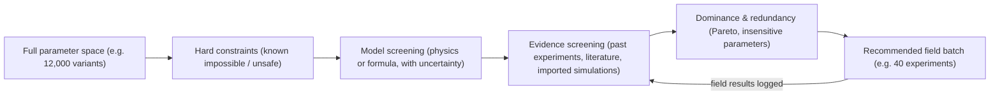
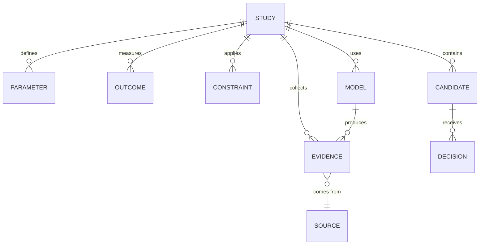

# Lattice — Roadmap to an Experiment-Reduction Engine

> **One-line goal:** Help a researcher go from *"there are 10,000 possible experiment variants"* to *"these 40 are worth running in the field, and here is the evidence for ruling out the rest."*

---

## 1. Positioning — what Lattice is (and is not)

Lattice will **not** compete with high-fidelity solvers (ANSYS Fluent, COMSOL, OpenFOAM, LAMMPS, Schrödinger, etc.). Those tools answer *"what happens in this one configuration, as accurately as possible?"*

Lattice answers a different question:

> **"Across the whole space of experiments I *could* run, which ones can I safely skip — and how sure am I?"**

| High-fidelity simulators | Lattice |
|---|---|
| One configuration, very accurate | Thousands of configurations, cheap screening |
| Physics expert required | Any researcher, any domain |
| Output: fields, plots | Output: **a shrinking list of candidate experiments + justification** |
| Ignores lab history | **Stores and learns from every past experiment** |
| Lattice can *import* their results as evidence | |

The core product is a **funnel**:

Every arrow removes candidates **with a recorded reason and a confidence level**. The loop at the end is what makes it get smarter over time.

---

## 2. Honest starting point

### What already exists and is directly reusable

- **A pure, deterministic evaluation engine.** [`execute(project)`](../src/core/runtime.ts) is a pure function `Project → Run`. That makes it a ready-made *model evaluator*: we can call it thousands of times with different parameters for sweeps, Monte Carlo and sensitivity analysis — no rewrite needed.
- **Typed node graph + safe formula compiler** ([`expression.ts`](../src/core/expression.ts)) — researchers can already express domain formulas without arbitrary code execution.
- **Web Worker execution** ([`runner.worker.ts`](../src/core/runner.worker.ts)) — batch runs won't freeze the UI.
- **Registry-driven extensibility** ([`registry.ts`](../src/core/registry.ts), [`scene-events.ts`](../src/core/scene-events.ts)) — new domains can add nodes without touching the UI.
- **38 passing tests**, project schema versioning and migration.

### What is missing (the real gaps)

1. **No concept of a parameter *space*.** A project holds one value per parameter. There are no ranges, distributions, or "study" of many variants.
2. **No data store for experimental evidence.** Persistence is a single JSON blob in browser `localStorage` (5 MB cap). There is nowhere to record "we ran this in the field on this date and got this result."
3. **No statistics layer.** No DoE, uncertainty propagation, sensitivity analysis, surrogate models, or confidence statements.
4. **The physics models are illustrative, not predictive.** Important for the tunnel example specifically: in the current water-mist event, **droplet diameter, flow rate and nozzle count only affect the visuals** — the pressure reduction is a user-entered percentage ([`scene-events.ts`](../src/core/scene-events.ts), `waterMist.effect`). So today the app *cannot* say anything about which droplet sizes work. Section 4 explains how that gets fixed: either a validated model, or real data, or both.
5. **UI and docs are Georgian-only;** a researcher-facing product will need at least English as well.

> [!IMPORTANT]
> **Statistics cannot rule anything out on its own.** An exclusion is only as trustworthy as the evidence behind it: a known hard limit, a model that has been checked against reality, or measured data. The whole design below is built around making that evidence explicit, so a scientist can see *why* something was ruled out and challenge it.

---

## 3. Core domain model (domain-agnostic)

These are the new first-class objects. Nothing in them is specific to tunnels or drugs.

| Object | Meaning | Examples |
|---|---|---|
| **Study** | A research question with a goal | "Mitigate methane blast overpressure in a 40 m tunnel" / "Find a non-toxic inhibitor for target X" |
| **Parameter** | A variable the researcher controls. Has type, unit, range/levels, optional prior distribution | droplet diameter 10–1000 µm; nozzle count 1–24; molecular weight 150–700 Da |
| **Outcome** | What is measured, plus a **success criterion** | peak overpressure at sensor < 8 kPa; IC50 < 100 nM; hepatotoxicity = negative |
| **Constraint** | A rule that must hold. **Hard** (exclude) or **soft** (penalise) | flow ≤ pump capacity; Lipinski's rule of five; budget ≤ €X; ethics/safety limits |
| **Model** | Anything that predicts outcomes from parameters: a Lattice flow graph, a formula, a fitted surrogate, or an imported external simulator table | existing tunnel graph; logistic toxicity model; Fluent results CSV |
| **Evidence** | A data point linking parameters → outcomes, **with provenance and uncertainty** | field trial #17; literature value (DOI); simulation run; expert judgement |
| **Candidate** | One concrete experiment variant (a point in the parameter space) | droplet = 80 µm, nozzles = 8, start = 1.25 s |
| **Decision** | The status of a candidate + reason + confidence | `excluded — P(success) < 2% (95% CI 0–5%), model M v3 + 14 trials` |

**Decision states:** `open` → `excluded` / `deprioritised` / `recommended` / `tested-pass` / `tested-fail`. Every exclusion is **reversible** and stores the exact evidence/model version it was based on, so if new data arrives, affected decisions are re-evaluated automatically.

---

## 4. How exclusions are made — the five filters

Ordered from most to least certain. The UI should always show which filter removed a candidate.

### Filter 1 — Hard constraints (deterministic, 100% certain)
Known limits written as formulas (reuse the existing safe formula compiler).
- Tunnel: `flow * nozzles <= pump_capacity`, `start_mist < ignition - rise_time`.
- Drug: Lipinski (`MW <= 500 && logP <= 5 && HBD <= 5 && HBA <= 10`), known toxic substructures, regulatory limits.

Often removes a big share of the space immediately at zero risk.

### Filter 2 — Model screening with uncertainty
Run the model (a Lattice flow graph or formula) over candidates, **but treat inputs as uncertain**, not as fixed numbers.
- **Monte Carlo propagation:** sample uncertain inputs (e.g. blast amplitude ± 20%, sensor bias) → distribution of outcomes per candidate.
- Exclude only if **P(success) < threshold** with the threshold set by the researcher (e.g. "exclude if < 5% chance").
- This is where the existing `execute()` engine is reused directly in a batch loop.

### Filter 3 — Evidence screening (data-driven)
Fit a statistical model to the stored evidence and predict success probability *with error bars* for untested candidates.
- **Gaussian-process classification/regression** — gives both prediction and uncertainty; ideal for small lab datasets (10–500 points).
- **Conformal prediction** — wraps any model to give guaranteed-coverage prediction intervals, a defensible way to say "excluded with 95% coverage."
- Regions with high uncertainty are **never** excluded — they become candidates for exploration instead.

### Filter 4 — Dominance and redundancy
- **Pareto dominance:** if candidate A is at least as good as B on every objective and cheaper, B is deprioritised.
- **Sensitivity analysis (Morris screening, Sobol indices):** if a parameter barely affects the outcome, collapse it to one level. Going from 6 nozzle-count levels to 1 shrinks the space 6×.

### Filter 5 — Experiment design for what remains
What survives is still often too many. Pick the **most informative** subset to actually run:
- **Design of Experiments:** fractional factorial, Latin hypercube, D-optimal designs.
- **Active learning / Bayesian optimisation:** choose the next batch that maximises expected information or probability of improvement under feasibility constraints.
- **Power analysis:** how many replicates are needed per candidate to detect the effect size that matters.

### Proving something *doesn't* work — statistical rigour
"We tested it and saw no effect" ≠ "it doesn't work." To support claims like *"droplets below X µm do not reduce overpressure,"* Lattice must use:
- **Equivalence testing (TOST):** shows the effect is *within a negligible margin*, not just "not significant".
- **Multiple-comparison control** (Holm, Benjamini–Hochberg) when screening many candidates at once, otherwise false exclusions pile up.
- **Explicit false-exclusion risk:** every study has a configurable "maximum acceptable chance of wrongly excluding a good candidate". This is the single most important setting in the product.

---

## 5. Worked examples

### A. Tunnel blast mitigation (droplet size)
1. **Parameters:** droplet 10–1000 µm, flow 1–150 L/min, nozzles 1–24, mist lead time 0–1 s → ~12,000 candidates on a reasonable grid.
2. **Hard constraints:** pump capacity, water budget, mist must be fully deployed before the shock arrives → removes e.g. 35%.
3. **Model:** replace the "user-entered reduction %" with a **pluggable mitigation model** (start with a published empirical correlation between droplet size, water loading and overpressure attenuation; mark it clearly as *model, unvalidated* until it is checked against data).
4. **Monte Carlo** over blast strength and distance → per-candidate P(peak < 8 kPa).
5. **Evidence:** log 10 field trials + 2 literature data sets → GP model calibrates/corrects the empirical model.
6. **Result:** "Droplets < 40 µm or > 400 µm: P(success) < 3% → excluded. Nozzle count above 10 has negligible effect (Sobol index 0.02) → fixed at 10. **Recommended next batch: 18 trials.**"

### B. Drug candidate screening
1. **Parameters:** candidate molecules (imported list, e.g. SMILES) + computed descriptors (MW, logP, charge, etc.).
2. **Hard constraints:** Lipinski / Veber rules, blacklisted toxic substructures.
3. **Model:** imported toxicity/activity predictions (from external tools) treated as uncertain evidence, not truth.
4. **Evidence:** in-house assay results.
5. **Result:** ranked shortlist for wet-lab assays, with each exclusion traceable to a rule, a model score or an assay.

> [!NOTE]
> Lattice should **not** implement chemistry or CFD itself. Domain computations (e.g. RDKit descriptors, CFD runs) are imported as columns/evidence. Lattice's job is the statistics, bookkeeping and decision logic on top.

---

## 6. Data storage — doing it properly

Researchers will trust the tool only if data is safe, traceable and exportable.

### Requirements
- **Immutable evidence records** — never edit a measurement; corrections create a new version linked to the old one.
- **Provenance on everything:** who, when, instrument/source, method, DOI/file reference, model version.
- **Units stored explicitly** and checked on import (the engine already carries units on packets — extend this to evidence).
- **Uncertainty stored with values** (± std, CI, or distribution), not just point numbers.
- **Missing data and failed runs are recorded**, not dropped — failures are evidence too.
- **Import/export:** CSV, Excel, JSON; later HDF5/Parquet for big data. Full study export as one archive for papers/reproducibility (FAIR principles).
- **Audit log** of every decision change.

### Architecture options (decision needed)

| Option | Pros | Cons |
|---|---|---|
| **A. Local-first: SQLite in the browser (WASM + OPFS)** | No server, data stays on the researcher's machine, works offline | Heavy statistics in JS is limited; no team sharing |
| **B. Python backend (FastAPI) + SQLite/PostgreSQL** | Access to SciPy, scikit-learn, statsmodels, SALib, BoTorch — the mature scientific stack; team sharing | Needs to be installed/hosted |
| **C. Hybrid (recommended):** UI + graph engine stay in the browser; a **local Python service** handles storage and statistics, upgradeable to a hosted server for teams | Best of both; start single-user, grow to labs | Two codebases to maintain |

> [!TIP]
> Re-implementing Gaussian processes, Sobol analysis and Bayesian optimisation in TypeScript would be slow to build and hard to validate. Using established Python libraries is the faster and more trustworthy path for the statistics core.

---

## 7. Researcher workflow (target UX)

1. **Create study** → pick a template (tunnel blast, drug screen, materials, blank).
2. **Define parameters & outcomes** with units, ranges and success criteria.
3. **Add constraints** in plain formulas.
4. **Attach a model** (an existing Lattice flow graph, a formula, or "data only").
5. **Import evidence** (CSV of past trials, literature values).
6. **Run screening** → see the **funnel view**: `12,000 → 7,800 → 2,100 → 640 → 120 → 18 recommended`, each step clickable to see what was removed and why.
7. **Explore** the space: 2D slices/heatmaps of P(success), sensitivity bar charts, Pareto front.
8. **Export field plan** (printable/CSV run sheet with randomised order and replicate counts).
9. **Log field results** → decisions re-evaluate → next batch recommended.
10. **Generate report** — methods, assumptions, exclusions with confidence, for papers or funding reports.

---

## 8. Phased roadmap

Each phase ships something usable on its own.

### Phase 0 — Foundations (1–2 weeks)
- Fix `npm test` for Node 20 (currently needs Node ≥ 22.6 for `--experimental-strip-types`; switch to `tsx` or pin Node version).
- Add English localisation alongside Georgian.
- Decide storage architecture (Section 6).
- Write a short **"model assumptions"** standard: every model/node declares validity range and validation status.

**Done when:** tests run on a standard setup; architecture decision recorded.

### Phase 1 — Studies, parameter spaces and hard constraints (3–4 weeks)
- New `Study`, `Parameter`, `Outcome`, `Constraint`, `Candidate`, `Decision` types and schema migration.
- Parameter ranges/levels on any numeric node field ("make this a study variable").
- Grid and Latin-hypercube candidate generation.
- Constraint evaluation via the existing formula compiler.
- **Funnel view v1** (constraints only) + candidate table with filter/sort/export.

**Done when:** a user can define the tunnel study, apply constraints and export the reduced candidate list. *Already useful — zero statistical risk.*

### Phase 2 — Evidence store (4–6 weeks)
- Persistent database per the chosen architecture; move off `localStorage`.
- Evidence import (CSV/Excel) with unit validation and column mapping.
- Provenance, uncertainty, versioning, audit log.
- Field-result logging form and run-sheet export.

**Done when:** a lab can record all its past and new trials with full traceability.

### Phase 3 — Batch model evaluation & uncertainty (4–6 weeks)
- Batch runner: evaluate a flow graph over N candidates in workers (reusing `execute()`).
- Parameter distributions (normal, uniform, log-normal, triangular) and **Monte Carlo propagation**.
- **Sensitivity analysis:** Morris screening, Sobol indices.
- Probabilistic exclusions with a configurable false-exclusion risk.
- Replace the tunnel water-mist "reduction %" with a pluggable, documented mitigation model (clearly flagged as unvalidated until compared with data).

**Done when:** the tunnel study produces P(success) per candidate and identifies insignificant parameters.

### Phase 4 — Learning from data (6–8 weeks)
- Gaussian-process surrogate models fitted to evidence (and to model runs for speed).
- Model calibration: combine physics model + field data (model discrepancy term).
- Conformal prediction intervals; equivalence tests; multiple-comparison control.
- **Model validation dashboard:** predicted vs measured, cross-validation, coverage checks. Models that fail validation are automatically blocked from making exclusions.

**Done when:** adding field data visibly changes predictions and exclusions, and every exclusion shows its confidence.

### Phase 5 — Experiment design & active learning (4–6 weeks)
- DoE generators: fractional factorial, D-optimal, space-filling.
- Bayesian optimisation / active learning batch selection under constraints.
- Power analysis for replicate counts.
- Multi-objective (Pareto) support including cost.

**Done when:** the app recommends "run these N next" and the recommendation measurably reduces trials in a back-test on historical data.

### Phase 6 — Reporting, collaboration, domain packs (ongoing)
- Auto-generated study report (Markdown/PDF): parameters, assumptions, funnel, exclusions, confidence.
- Multi-user projects, roles, comments on decisions.
- Domain packs (templates + node sets + example data): blast/fire safety, drug screening (descriptor import, Lipinski), materials/formulations, agriculture/biology dose–response.
- Connectors to import results from external simulators.

---

## 9. Measuring whether it actually helps

| Metric | Target | How measured |
|---|---|---|
| **Reduction ratio** | ≥ 80% of candidates excluded or deprioritised | Funnel stats per study |
| **False-exclusion rate** | ≤ user-set risk (e.g. 5%) | Back-test: hide historical results, re-run screening, check how many real successes were wrongly excluded |
| **Trials-to-answer** | Fewer field trials than standard DoE for the same conclusion | Retrospective comparison on real datasets |
| **Traceability** | 100% of exclusions have a reason + evidence link | Automated check |
| **Time to first useful result** | < 1 day for a new study | User testing |

> [!WARNING]
> The **false-exclusion rate** matters more than the reduction ratio. A tool that removes 90% of experiments but sometimes throws away the one that would have worked will quickly lose researchers' trust. Always report both numbers together.

---

## 10. Key risks

| Risk | Mitigation |
|---|---|
| Garbage model → confident wrong exclusions | Models must pass validation before they can exclude; unvalidated models can only deprioritise |
| Over-claiming ("proved it doesn't work") | Wording standard: *"excluded at X% confidence under model M given evidence D"*; equivalence testing for negative claims |
| Small datasets | GP/Bayesian methods suited to small n; high uncertainty ⇒ explore, never exclude |
| Scope creep into building solvers | Import external results; keep Lattice focused on statistics + decisions |
| Data loss / trust | Immutable records, backups, full export |
| Domain-specific regulation (e.g. pharma) | Audit trail designed in from Phase 2; formal compliance only if/when targeting regulated users |

---

## 11. Open decisions for the team

1. **Storage/statistics architecture:** browser-only, Python backend, or hybrid (recommended)?
2. **First target domain** for a real pilot with a real lab: tunnel/blast safety (existing demo) or something else?
3. **Single-user desktop tool first, or team/server product from the start?**
4. **Languages:** English + Georgian, or more?
5. **Pilot dataset:** which real historical experiment data can we get to back-test the false-exclusion rate?

