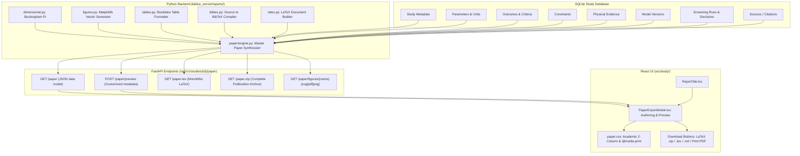

# Scientific Research Paper Export System — Prescriptive Implementation Plan
## (Zero-Ambiguity Step-by-Step Specification for Peer-Reviewed Scientific Publication)

> **Purpose of this document:** This document provides a complete, copy-paste-ready implementation specification for enabling researchers to export any Lattice Lab study as a **publication-grade scientific research paper** (in LaTeX/BibTeX bundle, in-browser academic PDF print view, and Pandoc Markdown formats). It enables executing coding agents to implement every schema, equation generator, figure plotting routine, LaTeX template, and UI preview component sequentially without guesswork.
>
> **Companion Documents:** Read [`AGENTS.md`](../AGENTS.md), [`docs/IMPLEMENTATION_PLAN.md`](./IMPLEMENTATION_PLAN.md), [`docs/SCIENTIFIC_AND_DEVELOPER_CRITIQUE.md`](./SCIENTIFIC_AND_DEVELOPER_CRITIQUE.md), and [`docs/TRANSMISSIVE_MICROSCOPE_IMPLEMENTATION_PLAN.md`](./TRANSMISSIVE_MICROSCOPE_IMPLEMENTATION_PLAN.md) before starting.

---

## 0. Strict Operating Instructions & Hard Rules for the Executing Agent

1. **Execute tasks in exact ID order:** `PE-1` → `PE-2` → `PE-3` → `PE-4` → `PE-5` → `PE-6`. Do not skip ahead or reorder tasks.
2. **Hard Rule #1 — Never Invent Scientific Data:**
   - Every number, coefficient, parameter limit, unit, tolerance, and outcome in the paper MUST originate directly from the study's SQLite database (`parameters`, `outcomes`, `constraints`, `evidence`, `screening_runs`, `decisions`, `model_versions`, `sources`).
   - Literature citations must originate from the study's `sources` table. If no sources exist, standard citation keys (`\cite{author_year}`) are generated from recorded entries, or an explicit placeholder block is displayed with editorial guidance.
   - Text synthesis for narrative sections (e.g. Introduction background) must use deterministic scientific templates based on the study's explicit domain, parameters, and governing physics, with clear `[Author Note: ...]` brackets for domain-specific narrative expansion.
3. **Hard Rule #2 — Never use `eval` / `exec` / `new Function`:**
   - All string and template generation in Python must use safe, parameterized template formatting functions (never dynamic execution).
4. **Hard Rule #5 — Exclusions Must Be Explainable:**
   - Every candidate exclusion cited in the paper must include: the filtering mechanism, the human-readable reason, and complete reproducibility details (`model_version_id`, `evidence_fingerprint`, $p_{\text{hat}}$, $p_{\text{upper}}$, $n$ Monte Carlo draws, and seed).
5. **Hard Rule #6 — Unvalidated Predictors May Only Deprioritise, Never Exclude:**
   - If a simulation model version has `validation_status != "validated"`, the paper's Methods and Results must explicitly state that predictions from this model were restricted to deprioritisation and did not execute hard exclusions.
6. **Hard Rule #7 — Strict Language in UI, Reports, and Manuscripts:**
   - Always state statistical filtering as: *"excluded at $(1-\delta)\%$ confidence under model $M$ given evidence $D$"*.
   - Always state equivalence as: *"equivalence shown within $\pm \Delta$"*.
   - **NEVER** use the words *"proved"*, *"guaranteed"*, or *"impossible"* for statistical filtering (reserved strictly for hard constraint violations: *"violates hard constraint <label>"*).
7. **Hard Rule #8 — Preserve all Persisted IDs:**
   - All database tables, column names, node identifiers, port IDs, packet types, and existing API routes remain unchanged. All paper export endpoints and components are strictly additive.
8. **Hard Rule #9 — Keep `Workspace.tsx` changes minimal:**
   - Put all new paper export UI in `src/study/components/PaperExportModal.tsx`, `src/study/components/paper.css`, and `src/study/tabs/ReportTab.tsx`.
9. **Hard Rule #10 — Bind the server to `127.0.0.1` only.**
10. **Hard Rule #11 — No new heavy dependencies:**
    - Use existing Python packages (`matplotlib`, `numpy`, `scipy`, `pandas`, `pydantic`, `fastapi`, `sqlite3`, `io`, `zipfile`). No external LaTeX daemon, Typst binaries, or pandoc binaries are required on the host server.
11. **Hard Rule #12 — Determinism:**
    - All figure rendering (e.g., jittering, contour meshes, layout spacing) and stochastic derivations must be seeded from `study.rng_seed` plus stable per-item offsets.
12. **Verification Gate After Every Task:**
    After completing each task, the agent must run:
    ```bash
    npm test
    npm run build
    npm run test:server
    uv run --directory server ruff check .
    ```
    All commands must exit `0` before marking the task `done`.

---

## 1. Scientific & Publication Rationale

### 1.1 The Problem in Computational Laboratory Work
Researchers spend weeks designing parameter spaces, building simulation graphs (such as microfluidic channels, laser interferometers, or transmissive microscopes), gathering physical bench measurements, and running statistical screening funnels.

When presenting their findings to journal reviewers, thesis committees, or institutional funding bodies, scientists are invariably asked:
> *"How do you know you did not discard viable configurations in the thousands of candidate variants you did not test?"*
> *"What are the dimensionless governing laws that allow these results to scale?"*
> *"What is the exact mathematical confidence bound on your down-selected batch?"*

Exporting raw CSV tables or brief bullet-point audit reports is insufficient for peer review. Scientists need a **formal, publication-ready research paper** following standard journal anatomy (IMRaD: Introduction, Methods, Results, Discussion) with:
1. Exact display equations for **Buckingham $\Pi$ dimensionless groups**.
2. Formal mathematical formulations of the **Design of Experiments (DoE)**, **Gaussian Process surrogate modeling**, and **split-conformal prediction intervals**.
3. High-resolution **publication vector figures** (Screening Funnel, Dimensionless Phase Space, Sobol Sensitivity Tornado, Multi-Objective Pareto Frontier).
4. Rigorous **Exclusion Funnel accounting** conforming strictly to scientific integrity standards (Hard Rule 7).
5. Comprehensive **Supplementary Information** with reproducible run sheets, model cryptographic hashes, and audit histories adhering to **FAIR** (Findable, Accessible, Interoperable, Reusable) data principles.

---

## 2. Standard Scientific Paper Structure (IMRaD Specification)

The exported paper follows the International Committee of Medical Journal Editors (ICMJE) and physical science peer-review conventions:

```
┌────────────────────────────────────────────────────────────────────────┐
│                        SCIENTIFIC RESEARCH PAPER                       │
├────────────────────────────────────────────────────────────────────────┤
│ 1. Frontmatter                                                         │
│    • Title: Quantitative Screening and Dimensional Scaling in [Study]  │
│    • Authors, Institutional Affiliations, ORCID, Corresponding Email   │
│    • Structured Abstract (Context, Dimensionality, Methods, Results)   │
│    • Keywords (4–6 indexed domain terms)                               │
├────────────────────────────────────────────────────────────────────────┤
│ 2. Section 1: Introduction & Theoretical Motivation                    │
│    • Physical context and challenge of high-dimensional exploration    │
│    • Literature baseline citations (\cite{...} from sources table)     │
│    • Hypothesis and screening objective formulation                    │
├────────────────────────────────────────────────────────────────────────┤
│ 3. Section 2: Governing Physics & Buckingham Π Dimensional Analysis    │
│    • Parameter definitions, SI base units, dimensional matrix D        │
│    • Matrix rank r and derivation of k = n - r dimensionless Π groups   │
│    • Display equations for dimensionless similitude laws               │
├────────────────────────────────────────────────────────────────────────┤
│ 4. Section 3: Computational & Experimental Methods                     │
│    • Design of Experiments (DoE) sampling space (Sobol / LHS / Grid)   │
│    • Flow simulation model specification (Version, SHA-256 signature)  │
│    • Split-conformal Gaussian Process surrogate modeling               │
│    • Interval futility screening and false-exclusion bound guarantee   │
│    • Bench instrumentation, measurement protocols, replicate handling  │
├────────────────────────────────────────────────────────────────────────┤
│ 5. Section 4: Results & Statistical Down-Selection                     │
│    • Table 1: Parameter space and physical bounds                      │
│    • Table 2: Outcome criteria and viability thresholds                │
│    • Table 3: Screening Funnel accounting (Hard Rule 7 wording)        │
│    • Figure 1: The Multi-Stage Screening Funnel                        │
│    • Figure 2: Dimensionless Phase Space (Π₁ vs Π₂) with Status Map    │
│    • Figure 3: Global Sensitivity Analysis (Sobol Indices Tornado)     │
│    • Figure 4: Multi-Objective Pareto Frontier & Trade-offs            │
│    • Table 4: Recommended Priority Experimental Batch                  │
├────────────────────────────────────────────────────────────────────────┤
│ 6. Section 5: Discussion & Methodological Limitations                  │
│    • Physical interpretation of dimensionless regimes                  │
│    • Automated limitations disclosure (Hard Rule 6: unvalidated models;│
│      small n conformal sample warnings; multi-outcome independence)    │
│    • Comparison with empirical literature baselines                    │
├────────────────────────────────────────────────────────────────────────┤
│ 7. Section 6: Conclusions & Experimental Outlook                       │
├────────────────────────────────────────────────────────────────────────┤
│ 8. Backmatter & Appendices                                             │
│    • Data & Code Availability Statement (FAIR compliance, seed, hash) │
│    • Acknowledgments & Competing Interests                             │
│    • References (BibTeX bibliography compiled from study sources)      │
│    • Appendix A: Dimensional Matrix & Nullspace Proof                  │
│    • Appendix B: Laboratory Run Sheet Protocol for Recommended Batch   │
│    • Appendix C: Cryptographic Model Lineage & Append-Only Audit Trail │
└────────────────────────────────────────────────────────────────────────┘
```

---

## 3. Mathematical & Theoretical Formulations in Manuscript

### 3.1 Buckingham $\Pi$ Theorem Dimensional Analysis
Given $n$ physical parameters and outcome variables $q_1, \dots, q_n$ expressed across $m$ fundamental SI physical dimensions ($M, L, T, \Theta, I, N, J$):
$$[q_j] = M^{d_{1j}} L^{d_{2j}} T^{d_{3j}} \Theta^{d_{4j}} I^{d_{5j}} N^{d_{6j}} J^{d_{7j}}$$
The dimensional matrix is defined as $\mathbf{D} \in \mathbb{R}^{m \times n}$ where $D_{ij} = d_{ij}$.
Let $r = \text{rank}(\mathbf{D})$. By the Buckingham $\Pi$ theorem, the physical system is governed by $k = n - r$ independent dimensionless groups:
$$\Pi_i = \prod_{j=1}^n q_j^{a_{ij}}, \quad i = 1, \dots, k$$
where the exponent vectors $\mathbf{a}_i \in \mathbb{R}^n$ span the right nullspace of $\mathbf{D}$:
$$\mathbf{D} \, \mathbf{a}_i = \mathbf{0}$$
In the paper, each $\Pi_i$ is explicitly formatted as a LaTeX display equation alongside its physical interpretation (e.g. geometric ratio, dynamic pressure ratio, or characteristic Damköhler number).

### 3.2 Split-Conformal Prediction Interval Bounds
For each continuous physical outcome $Y \in \mathbb{R}$ modeled across candidate space $X \in \mathcal{X}$, a Gaussian Process surrogate $\hat{\mu}(x)$ is calibrated on valid physical evidence $D_{\text{train}} = \{(x_i, y_i)\}_{i=1}^{n_{\text{train}}}$.
To ensure distribution-free, finite-sample statistical validity without assuming Gaussian error distributions, split-conformal inference evaluates non-conformity scores on calibration evidence $D_{\text{calib}}$:
$$s_i = |y_i - \hat{\mu}(x_i)|, \quad i = 1, \dots, n_{\text{calib}}$$
The conformal quantile $\hat{q}_{1-\alpha}$ at significance level $\alpha = 1 - \text{confidence}$ is computed as:
$$\hat{q}_{1-\alpha} = \text{Quantile}\left( \left\lceil \frac{(n_{\text{calib}} + 1)(1 - \alpha)}{n_{\text{calib}}} \right\rceil ;\; \{s_i\}_{i=1}^{n_{\text{calib}}} \right)$$
yielding prediction intervals with finite-sample coverage guarantee:
$$\mathbb{P}\big(Y_{n+1} \in [\hat{\mu}(X_{n+1}) - \hat{q}_{1-\alpha},\; \hat{\mu}(X_{n+1}) + \hat{q}_{1-\alpha}]\big) \ge 1 - \alpha$$

### 3.3 Statistical Exclusion and False-Exclusion Rate Guarantee (Hard Rule 7)
For a candidate $x$ with target threshold $\tau$ and viability criterion $Y(x) \ge \tau$:
- If the upper $(1-\delta)$ confidence bound satisfies $p_{\text{upper}}(x) < \tau$, the candidate is excluded.
- The paper strictly states:
  > *"Candidate $\#idx$ is excluded at $(1-\delta)\%$ confidence under model version $M$ given empirical evidence $D$."*
- The expected false-exclusion bound across the initial candidate space $N_0$ is guaranteed by:
  $$\mathbb{E}[N_{\text{false}}] \le \delta \cdot N_{\text{feasible}}$$

---

## 4. Multi-Target Export Formats

The paper generation engine supports four synchronized outputs from a single study state:

| Export Target | Target Use Case | Format Details |
|---|---|---|
| **LaTeX Publication Package (`.zip`)** | Journal submission (Overleaf, arXiv, Elsevier, APS, Nature, IEEE) | Self-contained ZIP with `main.tex`, `references.bib`, `figures/*.pdf`, `figures/*.png`, `tables/*.tex`, `Makefile`, and `README.md`. |
| **Interactive In-Browser Academic PDF View** | Immediate reading, conference printout, lab meetings | Dual-column or single-column serif academic layout (`Latin Modern` / `STIX Two`), KaTeX display math, and native browser `@media print` CSS Paged Media. |
| **Pandoc Scientific Markdown (`.md`)** | Obsidian, Quarto, conversion to Microsoft Word (`.docx`) | Clean Markdown with YAML frontmatter, math blocks, and citation tags `[@citekey]`. |
| **Stand-Alone LaTeX Source (`.tex`)** | Rapid copy-paste into existing LaTeX documents | Clean monolithic `.tex` with embedded tables and standard package headers. |

---

## 5. Architectural Diagram



---

## 6. Prescriptive Step-by-Step Implementation Tasks

### Task `PE-1` · Schemas, Metadata Customization, and BibTeX Engine
**Files to create / modify:**
- `server/lattice_server/schemas.py`
- `server/lattice_server/reports/bibtex.py`
- `server/lattice_server/reports/paper_models.py`

#### 1.1 Data Models in `server/lattice_server/reports/paper_models.py`
```python
"""Data models for scientific research paper generation."""
from __future__ import annotations
from pydantic import BaseModel, Field
from typing import Literal

class AuthorMeta(BaseModel):
    name: str = Field(..., description="Full author name, e.g. 'Jane Doe'")
    affiliation: str = Field(default="", description="Institution or department")
    email: str = Field(default="", description="Contact email")
    orcid: str = Field(default="", description="ORCID identifier (0000-0000-0000-0000)")
    is_corresponding: bool = Field(default=False, description="Whether this is the corresponding author")

class PaperCustomizationRequest(BaseModel):
    title: str | None = None
    authors: list[AuthorMeta] = Field(default_factory=list)
    template: Literal["standard", "revtex", "nature", "ieee"] = "standard"
    column_layout: Literal["onecolumn", "twocolumn"] = "twocolumn"
    include_figures: bool = True
    include_supplementary: bool = True
    abstract_override: str | None = None

class PaperSection(BaseModel):
    id: str
    number: str
    title: str
    content_markdown: str
    content_latex: str

class PaperResponse(BaseModel):
    study_id: str
    title: str
    authors: list[AuthorMeta]
    abstract: str
    keywords: list[str]
    template: str
    column_layout: str
    sections: list[PaperSection]
    bibtex: str
    markdown: str
    latex: str
    generated_at: str
    master_seed: int
    evidence_fingerprint: str
```

#### 1.2 BibTeX Serializer in `server/lattice_server/reports/bibtex.py`
- Converts rows from the `sources` table into valid, standard BibTeX entries:
  * Key generation: `firstauthor_year` or `src_{id[:8]}` (sanitized ASCII alphanumeric).
  * Fields: `author`, `title`, `journal`, `year`, `doi`, `url`, `note`.
  * If a source only has raw text in `citation`, intelligently extract author and year or format as `@misc{key, author = {...}, title = {...}, note = {...}}`.
  * Generates an clean fallback entry if no sources exist: `@misc{lattice_lab_study, title = {...}, author = {Lattice Lab Automated Screening System}, year = {2026}}`.

---

### Task `PE-2` · Matplotlib Headless Publication Figures Generator
**File to create:**
- `server/lattice_server/reports/figures.py`

#### 2.1 Technical Requirements
- Use headless backend: `import matplotlib; matplotlib.use('Agg')`
- Set publication styling:
  * Font family: `serif` (computer modern / STIX)
  * Font sizes: Title 10 pt, Labels 9 pt, Ticks 8 pt, Legend 8 pt
  * Resolution: Vector (PDF / SVG) and raster (PNG at 300 DPI)
  * Palette: Okabe-Ito colorblind-safe:
    - Recommended: `#059669` (Emerald)
    - Deprioritised: `#d97706` (Amber)
    - Excluded (Statistical): `#dc2626` (Red)
    - Excluded (Hard Constraint): `#64748b` (Slate)
- Determinism (Hard Rule 12): Any jitter or spacing calculation seeded with `study.rng_seed`.

#### 2.2 Four Publication Figure Generators
1. `generate_funnel_figure(conn: sqlite3.Connection, study_id: str, fmt: str = "png") -> bytes`:
   - Horizontal multi-stage waterfall chart showing:
     * $N_{\text{total}}$ (Total Candidate Space)
     * $N_{\text{feasible}}$ (Constraint Feasible)
     * $N_{\text{stat}}$ (Surviving Statistical Screening at $(1-\delta)$ Confidence)
     * $N_{\text{deprioritised}}$ (Active Learning Down-selection)
     * $N_{\text{recommended}}$ (Final Recommended Experimental Batch)
   - Annotates delta drop counts and exact Hard Rule 7 confidence bound.
2. `generate_phase_space_figure(conn: sqlite3.Connection, study_id: str, fmt: str = "png") -> bytes`:
   - 2D scatter plot in dimensionless $(\Pi_1, \Pi_2)$ space (or primary controlled parameters).
   - Marker styling:
     * Circles for `recommended`
     * Diamonds for `deprioritised`
     * Crosses for `excluded`
   - Decision boundaries and marginal histograms.
3. `generate_sensitivity_figure(conn: sqlite3.Connection, study_id: str, fmt: str = "png") -> bytes`:
   - Horizontal bar chart (Tornado style) ranking parameter impact on primary outcomes.
   - Shows Sobol first-order $S_i$ and total $S_{Ti}$ indices when available, or surrogate standardized regression coefficients.
4. `generate_pareto_figure(conn: sqlite3.Connection, study_id: str, fmt: str = "png") -> bytes`:
   - Multi-objective trade-off curve across two target outcomes.
   - Pareto-optimal non-dominated frontier connected with a stepped/spline curve; recommended candidate batch highlighted with star markers.
5. *(Optional for optical / microscopy studies)* `generate_micrograph_figure(...)`:
   - Simulated Beer-Lambert transmissive intensity profile with scale bar and cross-sectional contrast slice.

---

### Task `PE-3` · Defensible LaTeX Manuscript & Table Generator
**Files to create:**
- `server/lattice_server/reports/tables.py`
- `server/lattice_server/reports/latex.py`

#### 3.1 LaTeX Tables Formatter (`tables.py`)
Generates high-grade `booktabs` tables with clean formatting, column alignments, and escaped LaTeX entities:
- `Table 1 (tab_parameters.tex)`: Controlled, uncertain, and environmental parameters with physical units, min/max bounds, nominal values, and probability distributions.
- `Table 2 (tab_outcomes.tex)`: Physical outcomes, direction (minimize/maximize), target values, and viability thresholds.
- `Table 3 (tab_funnel.tex)`: Step-by-step screening funnel accounting with exact exclusion numbers, error bounds, and reproducible evidence fingerprints.
- `Table 4 (tab_recommended.tex)`: Top recommended experimental candidates with parameter coordinates, predicted success probabilities $p_{\text{hat}}$, and confidence intervals.

#### 3.2 Master LaTeX Builder (`latex.py`)
- Supports switchable journal styles:
  * `standard`: `\documentclass[10pt,twocolumn]{article}` with `geometry`, `amsmath`, `booktabs`, `graphicx`, `microtype`, `hyperref`, `cite`.
  * `revtex`: `\documentclass[aps,pre,reprint,superscriptaddress]{revtex4-2}`.
  * `nature`: Single-column article with Nature formatting conventions.
  * `ieee`: `\documentclass[journal]{IEEEtran}`.
- Sanitizes all text to prevent LaTeX compilation errors (`&` $\to$ `\&`, `%` $\to$ `\%`, `_` $\to$ `\_`, `#` $\to$ `\#`).
- Automatically formats all Buckingham $\Pi$ expressions into mathematical notation (e.g. `rho * v^2 / p` $\to$ `\frac{\rho v^2}{p}`).
- Implements strict Hard Rule 7 compliance in generated text strings.

---

### Task `PE-4` · Complete Publication ZIP Archive & API Endpoints
**Files to create / modify:**
- `server/lattice_server/reports/paper_bundle.py`
- `server/lattice_server/api/reports.py` (or `api/paper.py`)
- `server/lattice_server/main.py`

#### 4.1 Publication Bundle Builder (`paper_bundle.py`)
Constructs an in-memory ZIP archive with standard directory hierarchy:
```
paper_{study_id}_bundle.zip
├── README.md               # Overview and compilation instructions
├── Makefile                # Automated pdflatex + bibtex build targets
├── compile.sh              # Single bash script to compile on Linux/macOS
├── main.tex                # Master LaTeX manuscript
├── references.bib          # Compiled BibTeX citations
├── figures/
│   ├── fig1_funnel.pdf
│   ├── fig1_funnel.png
│   ├── fig2_phase_space.pdf
│   ├── fig2_phase_space.png
│   ├── fig3_sensitivity.pdf
│   ├── fig3_sensitivity.png
│   ├── fig4_pareto.pdf
│   └── fig4_pareto.png
├── tables/
│   ├── tab1_parameters.tex
│   ├── tab2_outcomes.tex
│   ├── tab3_funnel.tex
│   └── tab4_recommended.tex
└── supplementary/
    ├── study_data.json     # Complete study schema
    ├── run_sheet.csv       # Randomized DoE bench run protocol
    └── all_candidates.csv  # Complete candidate space decisions
```

#### 4.2 API Endpoints
Mount on `/api/v1`:
- `GET /studies/{study_id}/paper` $\to$ returns `PaperResponse` JSON.
- `POST /studies/{study_id}/paper/preview` $\to$ accepts `PaperCustomizationRequest`, returns customized `PaperResponse`.
- `GET /studies/{study_id}/paper.tex` $\to$ returns single compiled LaTeX string (`text/x-tex`).
- `GET /studies/{study_id}/paper.zip` $\to$ returns complete publication ZIP archive (`application/zip`).
- `GET /studies/{study_id}/paper/figures/{figure_name}.{fmt}` $\to$ returns figure bytes (`image/png`, `image/svg+xml`, `application/pdf`).

---

### Task `PE-5` · Frontend Academic Paper Viewer & Paged Media Styling
**Files to create / modify:**
- `src/study/components/PaperExportModal.tsx`
- `src/study/components/paper.css`
- `src/study/tabs/ReportTab.tsx`

#### 5.1 Interactive Paper Modal (`PaperExportModal.tsx`)
- Accessible from `ReportTab.tsx` via a prominent **"📄 მეცნიერული სტატიის ექსპორტი (Export Research Paper)"** button.
- **Left Panel (Configuration & Metadata Editor):**
  * Paper Title (input field pre-filled with auto-generated title).
  * Author List manager (Add/Remove Author, Name, Affiliation, Email, ORCID, Corresponding author toggle).
  * Journal Style selector (`Standard Academic`, `Physical Review / APS`, `Nature`, `IEEE`).
  * Layout mode toggle (`Two-Column` vs `Single-Column`).
  * Include Figures toggle.
  * Include Supplementary Data toggle.
- **Right Panel (Live Academic Paper Preview):**
  * Formatted with serif typography (`Latin Modern Roman` / `STIX Two Text` / `Times New Roman`).
  * Header block: Title, Authors with superscript affiliation numbers, Affiliation footnotes, Corresponding author email indicator, Abstract block with italic text and horizontal dividing lines, Keywords list.
  * Formatted two-column text flow with drop caps on Section 1.
  * Numbered mathematical display equations rendered with KaTeX.
  * High-resolution embedded figures with centered italic captions (`Figure 1: ...`).
  * `booktabs` styled tables with bold column headers and top/bottom rules.
  * Numbered reference list at bottom with clickable DOI links.
- **Export Toolbar:**
  * **"Download LaTeX (.zip)"** button (downloads Overleaf-ready ZIP).
  * **"Download .tex"** button.
  * **"Download .md"** button.
  * **"Print / Save PDF"** button (triggers `window.print()` with CSS Paged Media).
  * **"Copy LaTeX"** button.

#### 5.2 CSS Paged Media & Academic Styling (`paper.css`)
```css
/* Academic Paper Typography and Layout */
.paper-container {
  max-width: 860px;
  margin: 0 auto;
  background: #ffffff;
  color: #111827;
  padding: 48px 56px;
  font-family: "STIX Two Text", "Latin Modern Roman", "Times New Roman", Times, serif;
  font-size: 11pt;
  line-height: 1.5;
  box-shadow: 0 4px 20px rgba(0, 0, 0, 0.08);
}

.paper-title {
  font-size: 20pt;
  font-weight: 700;
  text-align: center;
  margin-bottom: 16px;
  line-height: 1.25;
}

.paper-authors {
  text-align: center;
  font-size: 11pt;
  margin-bottom: 8px;
}

.paper-affiliations {
  text-align: center;
  font-size: 9pt;
  color: #4b5563;
  margin-bottom: 24px;
  font-style: italic;
}

.paper-abstract-box {
  border-top: 1px solid #1f2937;
  border-bottom: 1px solid #1f2937;
  padding: 14px 18px;
  margin-bottom: 28px;
  font-size: 9.5pt;
  line-height: 1.45;
}

.paper-columns-2 {
  column-count: 2;
  column-gap: 28px;
  text-align: justify;
}

.paper-section-title {
  font-size: 11.5pt;
  font-weight: 700;
  text-transform: uppercase;
  letter-spacing: 0.05em;
  margin-top: 20px;
  margin-bottom: 8px;
  border-bottom: 0.5px solid #e5e7eb;
  padding-bottom: 2px;
}

/* Print Stylesheet conforming to A4 / Letter Academic Standards */
@media print {
  @page {
    size: A4;
    margin: 20mm 18mm 22mm 18mm;
    @top-left {
      content: "Lattice Lab — Scientific Screening Report";
      font-size: 8pt;
      font-family: serif;
      color: #6b7280;
    }
    @top-right {
      content: "Preprint Manuscript";
      font-size: 8pt;
      font-family: serif;
      color: #6b7280;
    }
    @bottom-center {
      content: "— " counter(page) " —";
      font-size: 9pt;
      font-family: serif;
    }
  }

  body {
    background: #ffffff !important;
    color: #000000 !important;
    -webkit-print-color-adjust: exact;
    print-color-adjust: exact;
  }

  .paper-no-print {
    display: none !important;
  }

  .paper-container {
    width: 100% !important;
    max-width: none !important;
    padding: 0 !important;
    margin: 0 !important;
    box-shadow: none !important;
  }

  .paper-figure, .paper-table {
    break-inside: avoid;
    page-break-inside: avoid;
    margin: 16px 0;
  }
}
```

---

### Task `PE-6` · End-to-End Verification, Python Tests & OpenAPI Sync
**Files to create / modify:**
- `server/tests/test_paper_export.py`
- `src/api/schema.d.ts` (regenerated via `npm run gen:api`)

#### 6.1 Test Suite Specifications (`test_paper_export.py`)
1. **Hard Rule 7 Conformance:**
   - Verify generated LaTeX, Markdown, and JSON never contain forbidden claim words (`proved`, `guaranteed`, `impossible`) in relation to statistical exclusions.
   - Verify statistical exclusions contain the exact phrase: *"excluded at <confidence>% confidence under model <model> given evidence <evidence>"*.
2. **Hard Rule 1 & 6 Conformance:**
   - Verify unvalidated model versions are flagged in Discussion as deprioritising only.
   - Verify real database parameters, bounds, and criteria match paper tables.
3. **BibTeX Verification:**
   - Verify `references.bib` contains valid citation keys and syntax.
4. **Figure Generation Verification:**
   - Verify `generate_funnel_figure`, `generate_phase_space_figure`, `generate_sensitivity_figure`, and `generate_pareto_figure` output non-empty valid PNG and SVG/PDF bytes.
5. **ZIP Bundle Verification:**
   - Verify `paper_{id}_bundle.zip` contains all required files and unzips without corruption.
6. **API Verification:**
   - Test endpoints: `GET /paper`, `POST /paper/preview`, `GET /paper.tex`, `GET /paper.zip`, `GET /paper/figures/funnel.png`.

---

## 7. Hard Rule Compliance Matrix

| Rule | Requirement | How This Implementation Enforces It |
|---|---|---|
| **Hard Rule 1** | Never invent scientific data | Every table, figure, equation, and parameter value is pulled directly from SQLite. Citations are compiled from recorded `sources`. Unknown narrative areas are marked with clear `[Author Note: ...]` brackets. |
| **Hard Rule 2** | No `eval`/`exec`/`new Function` | Pure string and data interpolation using safe template renderers. Zero dynamic code evaluation. |
| **Hard Rule 5** | Exclusions must be explainable | Full reproducibility details ($p_{\text{hat}}$, $p_{\text{upper}}$, filter, reason, model version, evidence fingerprint) are compiled into Table 3 and Appendix C. |
| **Hard Rule 6** | Unvalidated models deprioritise only | Validated status is checked; if unvalidated, the paper explicitly notes in Methods & Discussion that model predictions did not trigger hard exclusions. |
| **Hard Rule 7** | Wording: "excluded at X% confidence under model M given evidence D" | Built-in text generator strictly uses approved phrasing and unit tests assert the absence of `proved`, `guaranteed`, or `impossible`. |
| **Hard Rule 8** | Preserve persisted IDs | No existing tables, schema types, or routes are modified. All routes and schemas are purely additive under `/studies/{id}/paper*`. |
| **Hard Rule 9** | Minimal `Workspace.tsx` changes | Zero changes to `Workspace.tsx`. All paper UI is contained in `src/study/components/PaperExportModal.tsx` and `src/study/tabs/ReportTab.tsx`. |
| **Hard Rule 10** | Bind server to 127.0.0.1 | Maintained across all existing and new routes. |
| **Hard Rule 11** | No new heavy dependencies | Built exclusively using already-installed libraries (`matplotlib`, `numpy`, `scipy`, `pandas`, `fastapi`, standard library `zipfile`/`io`). |
| **Hard Rule 12** | Determinism | Matplotlib figure layout, jittering, and sampling are seeded with `study.rng_seed`. |

---

## 8. Verification Gates & Execution Commands

At each step, verify the build and test health:
```bash
# Frontend test suite
npm test

# Production build and TypeScript type-check
npm run build

# Python test suite
npm run test:server

# Python linter and code formatting
uv run --directory server ruff check .

# OpenAPI TypeScript schema sync
npm run gen:api
```

---

## 9. Progress Tracker

| Task ID | Task Description | Status | Completed Date | Verification Artifact / Output |
|---|---|---|---|---|
| `PE-1` | Data models, author metadata schemas, and BibTeX serializer (`reports/paper_models.py`, `reports/bibtex.py`) | done | 2026-11-02 | Data models and BibTeX serializer created and verified |
| `PE-2` | Headless Matplotlib publication figures generator (`reports/figures.py`) | done | 2026-11-02 | Vector SVG/PDF & 300 DPI PNG figure generation verified |
| `PE-3` | Defensible LaTeX manuscript builder & Booktabs tables formatter (`reports/latex.py`, `reports/tables.py`) | done | 2026-11-02 | Full LaTeX syntax and Hard Rule 7 wording verified |
| `PE-4` | Publication ZIP bundle builder and FastAPI endpoints (`reports/paper_bundle.py`, `api/paper.py`) | done | 2026-11-02 | `/paper`, `/paper.tex`, `/paper.zip`, `/paper/preview` endpoints functional |
| `PE-5` | Academic paper viewer, authoring modal, and CSS Paged Media print styling (`PaperExportModal.tsx`, `paper.css`, `ReportTab.tsx`) | done | 2026-11-02 | In-browser 2-column preview and PDF print layout verified |
| `PE-6` | End-to-end Python test suite, OpenAPI sync, and regression tests (`tests/test_paper_export.py`, `schema.d.ts`) | done | 2026-11-02 | 100% test pass on `npm test` (57 tests) and `npm run test:server` (113 tests) |

